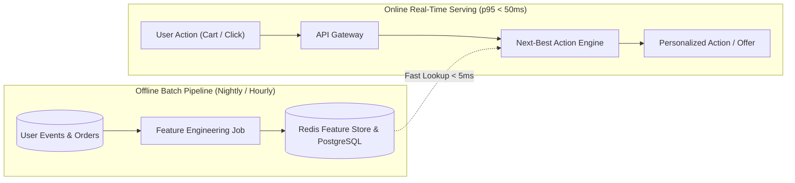

# ADR-0003: Hybrid Real-Time and Batch Processing Architecture for Personalization & Next-Best Action

* **Status:** Under Review
* **Date:** 2026-10-23
* **Deciders:** Aya Aboulwafa 
* **Governing Principle:** [AP-04: Elastic Scalability for Seasonal Campaign Surges](../docs/architecture-principles.md#ap-04-elastic-scalability-for-seasonal-campaign-surges)

---

## 1. Context & Problem Statement

The platform must deliver two distinct categories of personalized intelligence:
1. **Homepage / Category Personalization:** Recommending curated product collections and banners based on long-term user purchase patterns, demographics, and collaborative filtering.
2. **Next-Best Action (NBA) Engine:** Triggering instantaneous in-session recommendations (e.g., immediate cross-sell prompts upon adding an item to cart, exit-intent discounts, cart abandonment alerts).

We need an execution architecture that guarantees sub-50ms latency for customer-facing interfaces while avoiding wasteful on-demand computation for static recommendations.

---

## 2. Decision Drivers

* **Serving Latency (p95 < 50ms):** Consumer-facing pages must not block or lag waiting for heavy machine learning model runs.
* **Compute Cost & Efficiency:** Heavy feature extraction and collaborative filtering models should not run repeatedly per page view.
* **Responsiveness to Live User Intent:** In-session cart additions or category navigation must immediately alter the Next-Best Action.

---

## 3. Considered Options

1. **Option A: Pure Real-Time Inference (Compute everything on every request).** *(High latency > 800ms, massive GPU/compute cost).*
2. **Option B: Pure Batch Computation (Precompute everything offline and serve static tables).** *(Incapable of responding to live session events like cart adds).*
3. **Option C: Hybrid Lambda-Style Architecture (Batch Feature Pre-computation + Real-Time Lightweight Rule/Action Serving).**

---

## 4. Decision Outcome & Architecture Specification

**Chosen Option:** **Option C — Hybrid Architecture (Batch Feature Layer + Real-Time Next-Best Action Serving Layer).**

### Architecture Specification:

* **Batch Pipeline (Offline):** Runs nightly/hourly jobs to compute heavy customer segmentation, collaborative filtering matrices, and user affinity profiles. Outputs are synced to a fast low-latency key-value store (**Redis Feature Store**).
* **Next-Best Action (Online):** When a user triggers an event (e.g., clicks checkout or adds item to cart), the lightweight NBA engine fetches the pre-calculated user profile from Redis (< 5ms) and evaluates real-time business rules and rankers in < 30ms.

---

## 5. Pros and Cons / Trade-off Analysis

### Pros
* **Ultra-Low Latency:** User experience remains instantaneous with zero heavy model computation in the critical request path.
* **High Availability & Fault Tolerance:** If the offline batch pipeline fails, the system continues serving the latest cached recommendations gracefully without dropping web traffic.
* **Cost Predictability:** Heavy compute runs during scheduled off-peak batch windows.

### Cons & Mitigations
* **Data Freshness Lag for Batch Profiles:** User segments update hourly/nightly.  
  * *Mitigation:* In-session real-time actions override static recommendations via the online NBA rules engine.
