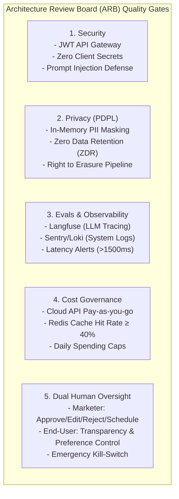
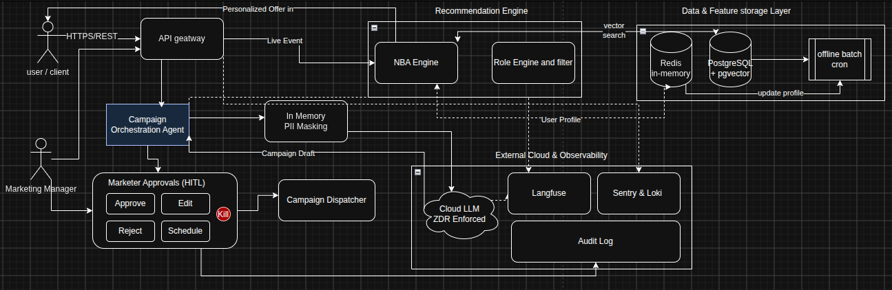

# 🏛️ Architecture Governance Pack — Marketing Automation with AI & Agents

* **System Name:** AI-Powered Marketing Automation Platform
* **AI Architect:** Aya Aboulwafa
* **Governance Scope:** Architecture Principles, Architecture Decision Records (ADRs), ARB Quality Gate
* **Course Context:** AI Architecture — Session 1 Mini Project

---

## 1. Executive Summary & Business Context

The **AI-Powered Marketing Automation Platform** empowers e-commerce growth by delivering intelligent real-time personalization, Next-Best Action (NBA) cross-sell recommendations, and automated agentic marketing campaigns.

### High-Level Business Goals & KPIs
* **Sales Take-Rate:** Increase promotional conversion and take-rate by **+80%** during peak sales seasons.
* **Customer Satisfaction (CSAT):** Elevate CSAT to **≥ 70%** through non-intrusive, privacy-first recommendations.
* **Operational Agility:** Reduce campaign generation and validation cycles from days to minutes using collaborative AI Agents with Human-in-the-Loop oversight.
* **Regulatory Compliance:** Strict zero-liability adherence to the **Saudi Personal Data Protection Law (PDPL)**.

---

## 2. Architecture Principles (TOGAF Aligned)

Five core architecture principles govern the platform. Each principle directly anchors technical implementations to high-level business goals:

| # | Principle Name | Architectural Statement | Linked Business Goal |
| :- | :--- | :--- | :--- |
| **[AP-01](architecture-principles.md#ap-01-strict-user-context-isolation)** | **Strict User Context Isolation** | Enforce tenant- and user-level isolation across databases, feature stores, and vector indexes. | **CSAT ≥ 70%** & Customer Trust |
| **[AP-02](architecture-principles.md#ap-02-robust-llm-guardrails--defense-in-depth)** | **Robust LLM Guardrails** | Inbound prompt sanitization and outbound content validation protect all LLM interactions. | Brand Safety & Campaign Integrity |
| **[AP-03](architecture-principles.md#ap-03-privacy-by-design--pdpl-compliance)** | **Privacy by Design & PDPL** | In-memory PII masking and Zero Data Retention (ZDR) guarantee absolute privacy compliance. | **PDPL Compliance** & Legal Safety |
| **[AP-04](architecture-principles.md#ap-04-elastic-scalability-for-seasonal-campaign-surges)** | **Elastic Scalability for Surges** | Decouple offline batch processing from online sub-50ms recommendation serving. | **+80% Sales Take-Rate** at Peaks |
| **[AP-05](architecture-principles.md#ap-05-zero-trust-api-security--decoupled-architecture)** | **Zero-Trust API Security** | Complete decoupling of frontend clients and backend services via authenticated API gateways. | High Availability & Defense |

*Detailed specifications: [Architecture Principles Document](architecture-principles.md)*

---

## 3. Architecture Decision Records (ADRs) Summary

Three foundational decisions define our compute, data, and serving strategies:

| ADR | Decision Topic | Evaluated Options | Chosen Decision | Key Trade-offs & Mitigations |
| :--- | :--- | :--- | :--- | :--- |
| **[ADR-0001](../adr/0001-cloud-llm-api-selection.md)** | **LLM Serving Strategy** | 1. Commercial Cloud API 2. Self-Hosted vLLM/Llama 3 3. Hybrid Model | **Option 1: Commercial Cloud LLM API with PII Masking** | **Gains:** Zero GPU maintenance, rapid time-to-market. **Sacrifice:** Per-token cost. **Mitigation:** In-memory PII masking, ZDR, prompt caching. |
| **[ADR-0002](../adr/0002-vector-database-pgvector.md)** | **Vector Datastore Selection** | 1. PostgreSQL `pgvector` 2. Dedicated Qdrant 3. Multi-model SurrealDB | **Option 1: PostgreSQL `pgvector` with 1M Scale Trigger** | **Gains:** Unified relational + vector store, zero sync drift, no extra cost. **Sacrifice:** Memory pressure at scale. **Mitigation:** HNSW indexing; migrate to Qdrant if vectors > 1M or p95 > 50ms. |
| **[ADR-0003](../adr/0003-hybrid-realtime-batch-processing.md)** | **Recommendation Serving Paradigm** | 1. Pure Real-time 2. Pure Batch 3. Hybrid Lambda-Style | **Option 3: Hybrid Architecture (Batch Profiles + Real-Time NBA)** | **Gains:** Ultra-low latency (p95 < 50ms), fault isolation. **Sacrifice:** Segments refresh hourly/nightly. **Mitigation:** In-session live actions override static profiles via Redis rules. |

---

## 4. Architecture Review Board (ARB) Quality Gate

The **ARB Checklist** defines mandatory verification gates across 5 pillars prior to production release:

### Pillar Summary Matrix
1. **Security:** Zero client secrets, decoupled frontend/backend, rate limiting, and prompt injection defense.
2. **Privacy (PDPL):** In-memory PII tokenization, vendor Zero Data Retention (ZDR), consent tracking, and right to erasure.
3. **Evals & Observability:** Full LLM tracing via **Langfuse**, backend exception tracking via **Sentry / Loki**, and automated latency alerts.
4. **Cost Governance:** Transparent token and compute cost tracking, spending caps, and Redis caching (target hit rate ≥ 40%).
5. **Dual Human Oversight:**
   * **Marketer Control:** Four explicit decision levers for campaign dispatch (**Approve**, **Edit**, **Reject**, or **Schedule**).
   * **End-User Agency:** Transparent interest confirmation and one-click removal of inferred preferences.
   * **Safety Mechanism:** Immutable audit trail and an emergency **Kill-Switch**.

*Detailed checklist: [ARB Checklist Document](arb-checklist.md)*

---

## 5. System Architectural Flow & Artifacts

The complete system architecture diagram is modeled in Draw.io, illustrating data flow, security perimeters, the hybrid serving pipeline, agentic workflows, and human oversight gates.

> 📥 **Draw.io Source Model:** [`diagrams/marketing-automation-architecture.drawio`](../diagrams/marketing-automation-architecture.drawio)

### Core Architectural Layers Illustrated
1. **Client & Edge Security Layer:** Web/Mobile clients terminate at an API Gateway enforcing JWT authentication, rate limiting, and inbound prompt sanitization.
2. **Hybrid Serving & Recommendation Pipeline:** Real-Time Next-Best Action (NBA) engine fetches user feature profiles from Redis (< 5ms) and queries PostgreSQL (`pgvector`) for catalog embeddings.
3. **Agentic Marketing Workflows:** Autonomous campaign agents generate multi-channel campaigns using Commercial Cloud LLMs via In-Memory PII Masking and Zero Data Retention (ZDR).
4. **Human Oversight & Safety Gate:** Marketer approval interface (Approve / Edit / Reject / Schedule) backed by an emergency Kill-Switch.
5. **Observability & Audit Plane:** Full-stack distributed tracing via **Langfuse** (AI traces/latency), **Sentry/Loki** (backend error logs), and an immutable Audit Trail.

### Repository Governance Deliverables Directory
* 🏛️ **Architecture Principles:** [`docs/architecture-principles.md`](architecture-principles.md)
* 📑 **Decision Records:** [`adr/`](../adr/)
* 📋 **ARB Production Checklist:** [`docs/arb-checklist.md`](arb-checklist.md)
* 📐 **Visual System Model:** [`diagrams/marketing-automation-architecture.drawio`](../diagrams/marketing-automation-architecture.drawio)
