> 🌐 **[اضغط هنا لفتح النسخة التفاعلية الكاملة (RTL Web Page) على GitHub Pages](https://aya-aboulwafa.github.io/ai-architecture-portfolio/)**

# 🏗️ AI Architecture — Session 1: Fundamentals, Frameworks & Practical Case Study

> [!abstract] 🎥 مصادر السيشن والفكرة الجوهرية
> - 🎥 **تسجيل السيشن الأولى (YouTube):** [AI Architecture — Session 1 Recording](https://www.youtube.com/watch?v=HUWlckeVwbM&t=6211s)
> 
> **الفكرة الجوهرية للـ Session:**
> الـ **AI Architecture** مش مجرد اختيار موديل أو كتابة كود، بل هو **الربط بين أهداف البيزنس (Business Goals) والتصميم التقني (Technical Design)** من خلال فهم المشكلة الحالية (**As-Is**)، وتحديد الشكل المستهدف (**To-Be**)، ودراسة الـ **Trade-offs**، وتطبيق معايير الجودة (**Quality Attributes / Perspectives**) مثل الـ Security والـ Performance على كل زاوية من زوايا النظام (**Views**).

---

# 📘 الجزء الأول: الأساس النظري وعقلية الـ Architect (Theoretical Foundation)

## 🛠️ 1. الأدوات الأساسية لأي Software / AI Architect
وأنت بتعمل الـ Architecture لأي سيستم هتحتاج 3 أدوات أساسية تشتغل بيهم بالتوازي:
1. **أداة للرسم المعماري (Diagramming Tool):** مثل `draw.io`، أو `Mermaid`، أو `Structurizr` لرسم الـ System Views.
2. **أداة للتوثيق (Wiki / Documentation Tool):** مثل `Word`، أو `Notion`، أو `Confluence`، أو `Obsidian` لكتابة الـ Architecture Design Document (ADD) والـ Requirements.
3. **بيئة التطوير (IDE):** لبناء الـ `POC (Proof of Concept)` والـ `Skeleton System` وتجربة القرارات عملياً.

---

## 🧠 2. شخصية وثقافة الـ Architect (The Architect Personality & Culture)

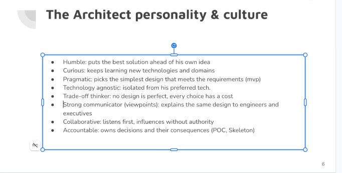

عشان تكون Architect ناجح، الموضوع بيبدأ بالـ Mindset وطريقة التفكير والتعامل مع التيم والـ Stakeholders:
- **متواضع ومتقبل للآراء (`Humble`):** يضع مصلحة المشروع وأفضل حل فوق فكرته الشخصية؛ لازم تتقبل كل الآراء وتجربها عملياً عشان تعرف **"ليه آه وليه لأ"** بناءً على التجربة العملية والدليل مش مجرد انطباعات.
- **فضولي ودائم التعلم (`Curious`):** يواكب التقنيات الجديدة ويفهم الـ Domains المختلفة.
- **عملي وواقعي (`Pragmatic`):** يختار أبسط تصميم يحقق المطلوب في المرحلة الحالية (`MVP`) بدون تعقيد غير مبرر (`Over-engineering`).
- **غير متعصب لتكنولوجيا معينة (`Technology Agnostic`):** منفصل عن تفضيلاته الشخصية؛ يختار الأداة بناءً على مدى ملاءمتها للمشكلة.
- **يفكر بمنطق المقايضات (`Trade-off Thinker`):** مفيش تصميم مثالي (`No design is perfect`)، كل اختيار له تكلفة (`Cost`) ومميزات وعيوب؛ دورك تحدد الـ **Trade-offs** وإيه الـ Tools اللي هتستخدمها **وليه اخترتها تحديداً**.
- **متواصل قوي (`Strong Communicator - Viewpoints`):** لازم يبقى عندك **Viewpoint** على حسب أنت بتكلم مين فهتكلمه إزاي؛ تشرح نفس الـ Design للمهندسين (`Engineers`) بتفاصيل تقنية، وللإدارة (`Executives`) بلغة البيزنس والتكلفة والعائد.
- **تعاوني (`Collaborative`):** يستمع أولاً، ويؤثر في الفريق بدون فرض سلطة (`Influences without authority`).
- **مسؤول عن قراراته (`Accountable`):** يتحمل نتيجة قراراته المعمارية ويثبت صحتها من خلال عمل `POC` و `Skeleton`.

---

## 🎯 3. مشروع عملي: أتمتة التسويق بالذكاء الاصطناعي (Marketing Automation with AI & Agents)

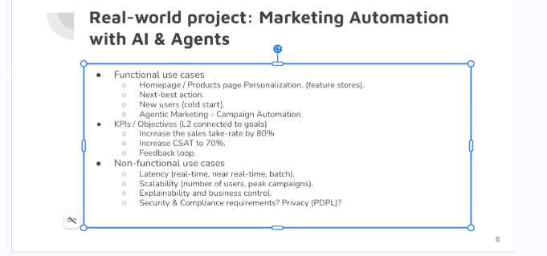

كمثال تطبيقي حقيقي، لما بنبص لمشروع **Marketing Automation** مدعوم بالـ AI والـ Agents، بنقسم الرؤية إلى 3 محاور:

### أ) حالات الاستخدام الوظيفية (`Functional Use Cases`)
- **تخصيص الصفحة الرئيسية والمنتجات (`Homepage / Products Page Personalization`):** بالاعتماد على الـ `Feature Stores` لعرض محتوى مخصص لكل شريحة أو مستخدم.
- **أفضل خطوة تالية (`Next-Best Action`):** توقع وتوجيه العميل للأكشن الأنسب له لحظياً.
- **التعامل مع المستخدمين الجدد (`New Users / Cold Start`):** إزاي نقدم تجربة ذكية ليوزر لسه معندناش ليه History كافي.
- **التسويق عبر الـ Agents (`Agentic Marketing - Campaign Automation`):** إزاي تخلي الـ Agent يعمل الـ Campaign ويديرها من البداية للنهاية.

### ب) مؤشرات الأداء والأهداف (`KPIs / Objectives - L2 connected to goals`)
- لازم يكون عندك نوعين من الـ KPIs تتكلم بيهم مع الـ Client وتربطهم بأهدافه:
  1. **Business KPIs:** مثل زيادة معدل التحويل والمبيعات (`Increase sales take-rate by 80%`)، ورفع رضا العملاء (`Increase CSAT to 70%`).
  2. **Technical KPIs & Feedback Loop:** مثل تتبع الـ Feedback والـ Quality والـ Latency في أدوات المراقبة زي **`Langfuse`** عشان تحسن الموديل باستمرار.

### ج) المتطلبات غير الوظيفية (`Non-Functional Use Cases / Quality Attributes`)
- **سرعة الاستجابة (`Latency`):** هل الـ Use Case محتاجة `Real-time` (لحظي وأنت فاتح الصفحة)، ولا `Near real-time`، ولا `Batch` (كل فترة في الخلفية)؟
- **قابلية التوسع (`Scalability`):** استيعاب عدد المستخدمين وأوقات ذروة الحملات (`Peak campaigns`).
- **قابلية التفسير والتحكم (`Explainability & Business Control`):** قدرة البيزنس على فهم "ليه الـ AI أخذ القرار ده" والتحكم في القواعد.
- **الأمان والامتثال والقوانين (`Security, Compliance & Privacy`):** لازم تبقى عارف قوانين البلد اللي هتعمل فيها البروجكت (مثل **`PDPL`** في السعودية/مصر أو **`GDPR`** في أوروبا)، ولازم يبقى عندك إجابة واضحة لأي سؤال يسأله الـ Client عن السيستم.

---

## 📋 4. جمع وتحليل متطلبات البيزنس (The Business Requirements)

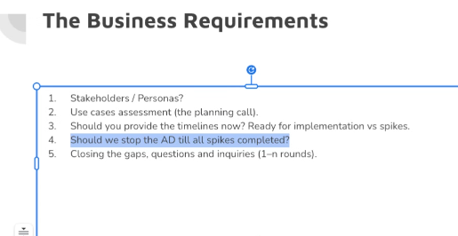

ما بعد تعريف البروجكت، بنبدأ نحدد الـ **Business Requirements** بدقة:
1. **سيناريو وقصة المشروع (`Project Story & Scenario`):** إيه القصة الكاملة للمشروع والمشكلة اللي بنحلها؟
2. **المعنيون والشخصيات (`Stakeholders / Personas`):**
   - السيستم هيشتغل إزاي مع الآخرين؟ هل هيتكامل مع سيستم تاني ولا هيستخدمه أشخاص مختلفين؟
   - تحديد كل **`Persona`** والصلاحيات (`Permissions / Roles`) الخاصة بكل منها.
3. **تقييم حالات الاستخدام وإغلاق الفجوات (`Use Cases Assessment & Closing the Gaps`):**
   - لازم تحلل البروجكت وتفكر فيه بعمق وتقفل كل الأسئلة المفتوحة (`1–n rounds` من الميتينجز في الـ Planning Call) لحد ما الدنيا كلها تكون واضحة.
4. **الجداول الزمنية والـ Spikes (`Timelines: Ready for Implementation vs. Spikes`):**
   - هل ندي Timelines دلوقتي؟ لازم نفرق بين المهام الواضحة الجاهزة للتنفيذ (`Ready for implementation`) والمهام اللي محتاجة بحث وتجربة أولية (`Spikes`).
   - سؤال مهم: *هل نوقف الـ Architecture Design (`AD`) لحد ما كل الـ Spikes تخلص؟* بنوازن بين استكمال التصميم الأساسي وتشغيل الـ Spikes بالتوازي في الأجزاء الغامضة.
5. **فصل الأدوار (`Role Boundaries - Why/What vs. How/When`):**
   > [!warning] قاعدة ذهبية في التعامل مع البيزنس
   > **مينفعش تاخد قرار Business من نفسك!**  
   > البيزنس يملك الـ **`Why & What`** (ليه بنعمل ده وإيه المطلوب)، بينما أنت كـ Architect تملك الـ **`How & When`** (إزاي هنبنيه تقنياً وإمتى هيتسلم) — فلازم كل طرف يعرف الـ Role بتاعه ويلتزم بيه.

---

## 🏛️ 5. أطر العمل المعمارية (Architecture Frameworks)

### أولاً: مدرسة الـ TOGAF (The Open Group Architecture Framework)

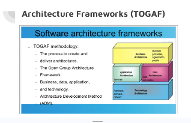

- **الفلسفة الأساسية:** أنت بتبدأ **بالبيزنس مش بالتكنولوجيا**!
- **طبقات TOGAF الأربع:**
  1. `Business Architecture` (العمليات، المؤسسة، الأشخاص).
  2. `Data Architecture` & `Application Architecture` (البيانات والخدمات).
  3. `Technology Architecture` (الهاردوير، السوفتوير، الشبكات).
- **منهجية تطوير المعمارية (`ADM - Architecture Development Method`):** تعتمد على فهم الوضع الحالي (`As-Is`) والسيستم شغال إزاي دلوقتي، وإيه المشكلة اللي محتاجين عشانها نبني البروجكت الجديد (`To-Be`).

### ثانياً: إطار عمل Zachman Framework

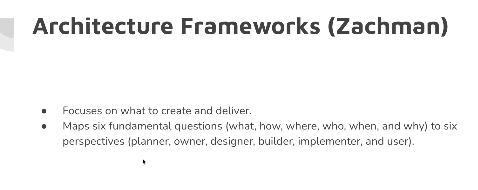

- يركز على **ماذا سننشئ ونسلم (`Focuses on what to create and deliver`)**.
- يربط 6 أسئلة أساسية (**`What, How, Where, Who, When, Why`**) بـ 6 منظورات للمعنيين (**`Planner, Owner, Designer, Builder, Implementer, User`**).

### ثالثاً: إطار عمل الـ C4 Framework (Maps of Your Code)

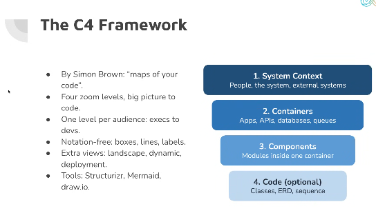

صممه *Simon Brown* كـ 4 مستويات تقريب (`Four zoom levels` من الصورة الكبيرة إلى الكود)، بحيث كل مستوى يخاطب فئة معينة من الإدارة (`Execs`) للمطورين (`Devs`):

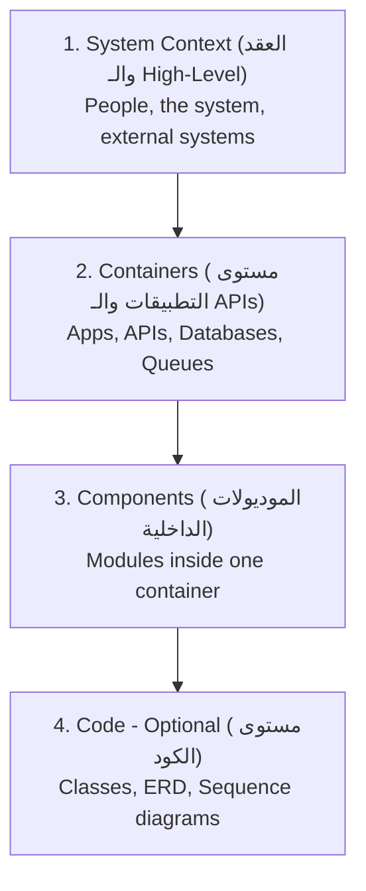

- **المستوى 1 (`System Context`):** ده يعتبر **العقد (`Contract`)** اللي بيحدد كل شيء هيتعمل على الـ High-level وعلاقة السيستم بالـ Users والأنظمة الخارجية.
- **المستوى 2 (`Containers`):** بيتكلم بشكل مفصل أكتر شوية (تطبيقات، قواعد بيانات، Queues، APIs) وهتحتاج فيه غالباً ترسم Diagrams واضحة.
- **المستوى 3 و 4 (`Components` & `Code`):** تفاصيل الموديولات والكلاسات جوه كل Container.
  > [!tip] ملاحظة عملية
  > **آخر اتنين (`Components` & `Code`)** في الغالب الـ AI يقدر يعملهم أو يولدهم بسهولة، لكن **أول اتنين (`System Context` & `Containers`) لازم أنت تفكر فيهم كويس جداً** لأنهم أساس القرار المعماري.

---

## 🔄 6. عملية تطوير المعمارية وأهمية الـ POC (Architecture Development Process)

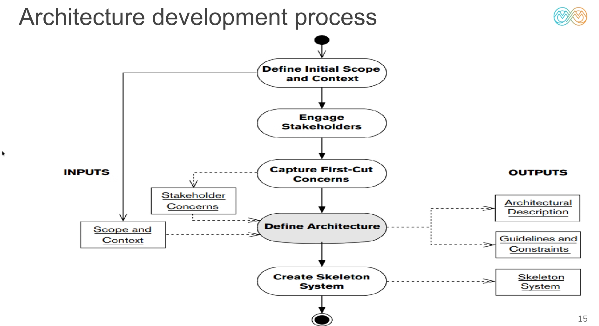

خطوات بناء المعمارية بتمشي في تسلسل واضح:
1. **`Define Initial Scope and Context`** (تحديد النطاق المبدئي والسياق).
2. **`Engage Stakeholders`** (إشراك المعنيين وأصحاب المصلحة).
3. **`Capture First-Cut Concerns`** (جمع المخاوف والمتطلبات الأولية).
4. **`Define Architecture`** -> وبيطلع منها مخرجان أساسيان: `Architectural Description` + `Guidelines and Constraints`.
5. **`Create Skeleton System / POC`**:
   - **ليه بنعمل POC (Proof of Concept)؟** الأفضل دايماً تعمل POC أو Skeleton System عشان تشوف وتتأكد عملياً: *هل كل الاتفاقات والتصميمات دي تطبيقها صح فعلاً على أرض الواقع ولا لأ؟*
   - دي خطوة بتخليك **تكتشف الأخطاء بدري جداً (Fail Fast)** أو تتأكد إن الوضع تمام فتكمل وتبدأ البناء بثقة.

---

## 🔍 7. الزوايا المعمارية وخصائص الجودة (Views & Architectural Perspectives)

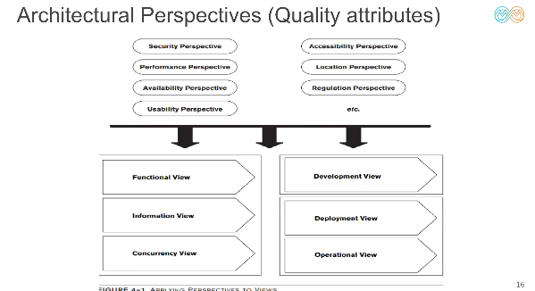

في التصميم المعماري بنفرق بين مفهومين بيكملوا بعض:
- **الـ Views (زوايا رؤية النظام):** بتمثل السيستم من زوايا مختلفة:
  - `Functional View` | `Information View` | `Concurrency View`
  - `Development View` | `Deployment View` | `Operational View`
- **الـ Perspectives (Quality Attributes / خصائص الجودة):** الصفات غير الوظيفية اللي لازم تتطبق عبر الـ Views:
  - `Security` | `Performance` | `Availability` | `Usability` | `Accessibility` | `Location` | `Regulation` | `Evolution`

### إزاي بنطبق الـ Perspectives على الـ Views؟

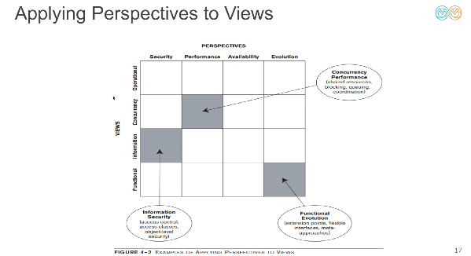

- القاعدة هي إنك **بتعمل Apply لكل Quality Attribute (Perspective) على كل الـ Views الموجودة**:
  - **مثال 1 (`Information View` × `Security Perspective`):** ينتج عنه `Information Security` (مثل الـ Access Control، وتصنيف البيانات، والـ Object-level security).
  - **مثال 2 (`Concurrency View` × `Performance Perspective`):** ينتج عنه `Concurrency Performance` (إدارة الـ Shared resources، والـ Queuing، ومنع الـ Blocking).
  - **مثال 3 (`Functional View` × `Evolution Perspective`):** ينتج عنه `Functional Evolution` (تصميم Interfaces مرنة تقبل التوسع مستقبلاً).

---

## ⚡ 8. المعمارية مع منهجية Agile (Architecture & Agile)

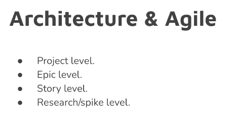

توزيع القرارات المعمارية داخل Agile بيتقسم على 4 مستويات:
1. **`Project Level`:**
    تقدر تخلي القرارات على مستوى الـ Project **ثابتة ومستقرة** من البداية (زي الـ `Deployment`، والـ `Infrastructure`، والـ Cloud، والـ Security Baseline).
2. **`Epic Level`:** تصميم التكامل بين المكونات الكبيرة للميزة (`Feature / Epic`).
3. **`Story Level`:** تفاصيل التنفيذ المباشرة داخل الـ Sprint.
4. **`Research / Spike Level`:** تجارب بحثية سريعة لحسم أي غموض تقني قبل تحويله إلى Stories.

---
---

# 🛠️ الجزء الثاني: التطبيق العملي في الـ Session (Practical Workshop)

> [!info] 
> بعد شرح الأساس النظري، حان وقت إننا نطبق عملياً خطوة بخطوة على مشروع **Marketing Automation Architecture Design**:
> 1. فتح **Document** موحدة لتوثيق المعمارية (`Architecture Design Document`) ونكتب فيها: الـ **Problem Statement**، الـ **Goals & Non-Goals**، الـ **Requirements**، الـ **Assumptions**، والـ **Viewpoints**.
> 2. نرسم دياجرام النظام الحالي **`System As-Is`**، ثم أخذ منه نسخة (`Copy`) ونبنى فوقها التعديلات الجديدة لنرسم النظام المستهدف **`System To-Be`** بعد إضافة طبقات الـ AI.

---

## 📄 أولاً: توثيق المعمارية (Architecture Design Document - ADD)

### 1. تعريف المشروع والمشكلة (`Project Overview & Problem Statement / Pain Points`)
النظام عبارة عن منصة تجارة إلكترونية / تسويق محتاجة تتحول لـ **AI-Driven Marketing Automation System**.  
أهم نقاط الألم في النظام الحالي (**`Pain Points`**):
1. **`Static Home Page` -> `Personalized per Segment`:** الصفحة الرئيسية حالياً ثابتة لكل الزوار، والمطلوب تحويلها لصفحة مخصصة ديناميكياً لكل شريحة أو مستخدم (`Personalized per segment/user`).
2. **غياب التخصيص اللحظي (`Lack of Real-time Recommendations`):** العميل لا يظهر له `Next-Best Action` أو منتجات مناسبة لاهتماماته الحالية.
3. **الحملات التسويقية اليدوية (`Manual Campaigns`):** إعداد الحملات يتم بشكل يدوي تقليدي وبطيء بدون استغلال الـ `AI Agents`.
4. **مشكلة المستخدم الجديد (`Cold Start Problem`):** الزوار الجدد بيحصلوا على تجربة عامة غير جذابة لعدم وجود سجل تصفح سابق لهم.

---

### 2. الأهداف وما خارج النطاق (`Goals` vs. `Non-Goals`)

| 🎯 الأهداف (`Goals` - ما سنحققه) | 🚫 خارج النطاق (`Non-Goals` - ما لن نفعله حالياً) |
| :--- | :--- |
| تحويل الـ Static Homepage إلى صفحة مخصصة لكل شريحة (`Personalized per Segment`). | عدم إعادة بناء نظام الـ Core E-Commerce أو الـ Checkout من الصفر. |
| بناء **`Segmentation Model`** لتقسيم العملاء ديناميكياً بناءً على سلوكهم. | عدم تدريب Foundation LLM خاص من الصفر (سنعتمد على موديلز جاهزة / Fine-tuned / APIs). |
| بناء **`Recommendation System`** يقترح أفضل المنتجات والـ `Next-Best Action`. | عدم استبدال أنظمة الـ ERP أو الـ Inventory الحالية، بل التكامل معها فقط. |
| أتمتة الحملات التسويقية عبر **`AI Agents`** مع تطبيق حوكمة وأمان كامل (`AI Guardrails`). | أي Features إضافية خارج نطاق التسويق والتخصيص في هذه المرحلة (لمنع الـ `Scope Creep`). |

> [!tip] ليه بنكتب الـ `Non-Goals` في الـ Document؟
> كتابة الـ **Non-Goals** بوضوح من أول يوم بتحمي المشروع من تمدد النطاق (`Scope Creep`)، وبتخلي التيم والـ Client متفقين تماماً على حدود المشروع والجدول الزمني.

---

### 3. الافتراضات وتخطيط السعة والأداء (`Assumptions & Capacity Planning`)

من أهم الأجزاء في الـ Document هي **الافتراضات المبنية على أرقام البيزنس (`Assumptions`)** لأنها اللي بتحدد حجم الـ Infrastructure والـ Concurrency:

- **الأداء والتزامن في أوقات الذروة المعتادة (`Performance & Concurrency in Peak Hours`):**
  - بالرجوع لأرقام التشغيل في **آخر 6 شهور**، أقصى عدد مستخدمين متزامنين (`Concurrent Users`) في ساعات الذروة اليومية (`Peak Hours`) بيوصل إلى حوالي **`50 Concurrent Users`**.
- **المواسم والأعياد (`Seasonality - Ramadan & Holidays`):**
  - في فترات المواسم مثل **شهر رمضان، الأعياد (`Holidays`)، ومواسم العروض الكبرى**، الترافيك بيزيد بشكل ملحوظ وبيوصل التزامن إلى حوالي **`100 Concurrent Users`** (الضعف تقريباً).
- **أثر هذه الـ Assumptions على التصميم المعماري:**
  - تصميم الـ APIs والـ Model Inference بحيث تستوعب `50–100 Concurrent Users` بأمان بدون `Bottlenecks`.
  - تفعيل الـ **Auto-scaling** والـ **Caching** (مثل `Redis` / `Feature Store`) في مواسم رمضان والـ Holidays بدل حجز سيرفرات ضخمة طوال السنة بدون داعي.

---

## 👁️ ثانياً: تطبيق الـ Viewpoints & Perspectives على المشروع

في الـ Document، بدأنا نطبق الـ **Views** ونربطها بالـ **Quality Attributes (Perspectives)**، ومن أهم الأمثلة اللي طبقها:

### 1. زاوية الأمان والامتثال (`Security View / Perspective`) 🔒
لما بنبص للسيستم من زاوية الـ **Security**، بنغطي 3 طبقات أساسية:

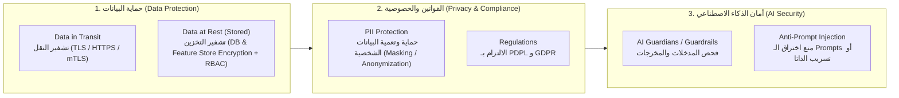

1. **حماية البيانات في حالتيها (`Data in Transit` & `Data Stored / At Rest`):**
   - **`Data in Transit` (أثناء النقل):** تأمين وتشفير كل حركة البيانات بين الـ Frontend، والـ Backend، والـ AI Models عبر بروتوكولات التشفير (`HTTPS / TLS / mTLS`).
   - **`Data Stored / At Rest` (أثناء التخزين):** تشفير قواعد البيانات، الـ Data Warehouse، والـ Feature Stores، مع تحديد صلاحيات الوصول بدقة (`Role-Based Access Control - RBAC`).
2. **الخصوصية والامتثال القانوي (`PII`, `PDPL`, `GDPR`):**
   - التعامل الحذر جداً مع **البيانات الشخصية (`PII - Personally Identifiable Information`)** مثل اسم العميل، رقمه، إيميله، وعمل `Masking / Anonymization` لها قبل ما تروح لأي موديل AI.
   - التوافق الكامل مع قوانين حماية البيانات مثل **`PDPL`** (قانون حماية البيانات الشخصية) و **`GDPR`**.
3. **حماية نماذج الذكاء الاصطناعي (`AI Guardians & Prompt Injection Defense`):**
   - وجود طبقة **`AI Guardians / Guardrails`** قبل وبعد الموديل.
   - الحماية من هجمات **`Prompt Injection`** و `Jailbreaking` عشان مفيش مستخدم يتلاعب بالـ Agent أو يخليه يطلع بيانات عملاء تانيين أو يخرج عن سياق البيزنس.

---

### 2. زاوية النشر والبنية التحتية (`Deployment View`) 🚀
بتوضح إزاي المكونات البرمجية والموديلز هتتنشر وتشتغل على الهاردوير أو الكلاود:
- **بيئة الاستضافة (`Hosting & Residency`):** تحديد هل الـ Deployment هيكون على **Cloud** (مثل AWS / GCP / Azure) ولا **On-Premise / Local Cloud Region** داخل نفس البلد لتحقيق شروط الـ `PDPL`.
- **الحاويات والتشغيل (`Containerization & Orchestration`):** تشغيل الـ Services والـ AI Models داخل `Docker Containers` وإدارتها بـ `Kubernetes / Cloud Run` مع `Load Balancer`.
- **التوسع في المواسم (`Scaling for Seasonality`):** ضبط الـ Auto-scaling ليتعامل مع الـ `50 Concurrent Users` في الأيام العادية، ويتمدد تلقائياً لـ `100+ Concurrent Users` في رمضان والـ Holidays.
- **فصل البيئات (`Environments`):** عزل بيئات `Development`، و `Staging`، و `Production` مع خطوط `CI/CD & MLOps`.

---

### 3. زوايا معمارية أخرى (`Other Views` — مساحة للتكملة) 🧩
> [!todo] ملاحظات إضافية على باقي الـ Views (للتكملة)
> - **`Information / Data View`:** (إدارة مصادر البيانات، الـ Feature Store، تدفق البيانات للـ Segmentation والـ Recommendation، والـ Data Governance).
> - **`Concurrency View`:** (إدارة الطلبات المتزامنة، الـ Async Queues في حملات الـ Marketing، ومنع الـ Bottlenecks وقت الذروة).
> - **`Operational & Monitoring View`:** (متابعة الـ Logs، والـ Traces، والـ Model Drift، والـ Feedback Loop عبر أدوات مثل `Langfuse` و `Prometheus/Grafana`).
> - *(أضيفي أي ملاحظات أو صور إضافية خاصة بباقي الـ Views هنا)*

---

## 🗺️ ثالثاً: الرسم المعماري للنظام — من الـ `As-Is` إلى الـ `To-Be`

في الجزء الأخير من السيشن، طبق الـ Instructor منهجية رسم الوضع الحالي ثم التعديل عليه لبناء الوضع المستهدف:

### 1. النظام الحالي قبل التطوير (`System As-Is Diagram`)
- يعبر عن السيستم الموجود حالياً: المستخدم بيدخل على ويب سايت أو أبلكيشن بيعرض **`Static Homepage`**، بيتواصل مع الباك إند التقليدي وقواعد البيانات بدون وجود تخصيص ذكي أو طبقات AI.

> [!image] 📸 مساحة لإضافة صورة الـ `As-Is Diagram` من المحاضرة
> *(انسخي والصقي صورة الـ **As-Is Diagram** هنا)*
> 

#### دياجرام توضيحي مبسط للـ `System As-Is`:
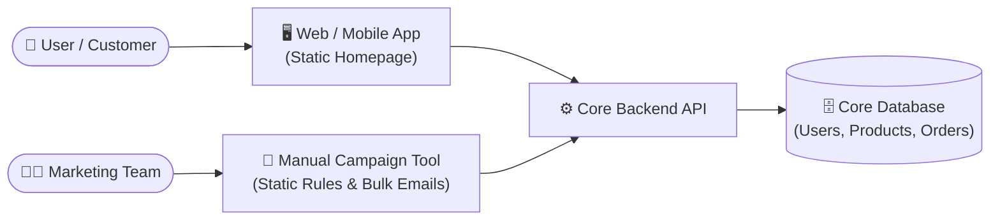

---

### 2. النظام المستهدف بعد إضافة الذكاء الاصطناعي (`System To-Be Diagram`)
- أخذ الـ Instructor نسخة (`Copy`) من دياجرام الـ **`As-Is`** وبدأ يضيف عليه مكونات وطبقات الـ AI الجديدة عشان يتحول إلى **`To-Be`**:
  1. **`AI for Security (AI Guardrails / Guardians)`:** طبقة أمان ذكية في الواجهة لفحص المدخلات والمخرجات، منع الـ `Prompt Injection`، وحماية الـ `PII` وفقاً للـ `PDPL / GDPR`.
  2. **`Segmentation Model`:** موديل لتقسيم العملاء إلى شرائح ديناميكية (`Dynamic User Segments`) بناءً على تفاعلاتهم وبياناتهم في الـ `Feature Store`.
  3. **`Recommendation System`:** محرك توصيات يعتمد على شريحة العميل وسلوكه ليقدم **`Personalized Homepage / Products`** و **`Next-Best Action`** (مع معالجة الـ `Cold Start` للمستخدمين الجدد).
  4. **`Agentic Marketing / Campaign Automation`:** نظام Agents ذكي يساعد فريق التسويق في تصميم وإطلاق وتخصيص الحملات أوتوماتيكياً مع وجود **`Feedback Loop`** (مثل `Langfuse`) لقياس الـ KPIs.

> [!image] 📸 مساحة لإضافة صورة الـ `To-Be Diagram` من المحاضرة
> *(انسخي والصقي صورة الـ **To-Be Diagram** هنا)*
> 

#### دياجرام معماري متكامل للـ `System To-Be`:
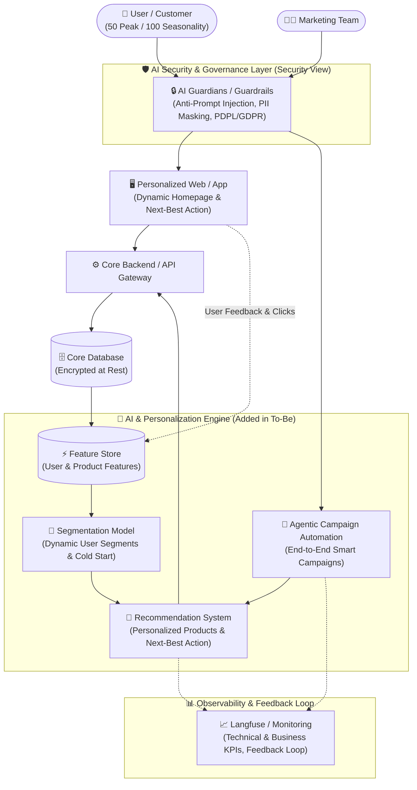

---

## ✅ ملخص سريع لخطوات العمل العملي لأي مشروع AI Architecture
1. **افهم البيزنس أولاً (`TOGAF`):** اسأل عن الـ Story، الـ Personas، والـ Pain Points، وتذكر أن البيزنس يملك الـ `Why & What` وأنت تملك الـ `How & When`.
2. **اكتب الـ `Architecture Design Document`:** وثّق الـ `Goals`، والـ `Non-Goals`، والـ `Requirements`، والـ `Assumptions` بالأرقام (مثل الـ `Peak Concurrency = 50` والـ `Seasonality = 100`).
3. **طبّق الـ `Perspectives` على الـ `Views`:** ركز بشكل خاص على الـ **`Security View`** (`Data in Transit & Stored`، `PII`، `PDPL/GDPR`، `AI Guardians`، `Prompt Injection`) والـ **`Deployment View`**.
4. **ارسم الـ `As-Is` ثم ابني عليه الـ `To-Be`:** ابدأ بالنظام الحالي، ثم انسخه وضيف عليه طبقات الـ AI (`AI Security`، `Segmentation Model`، `Recommendation System`، `Marketing Agents`).
5. **اختبر قراراتك بـ `POC / Skeleton`:** للتأكد من صحة التصميم عملياً واكتشاف الأخطاء مبكراً.

---

