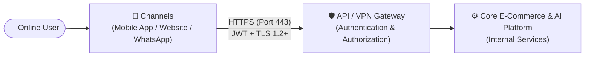
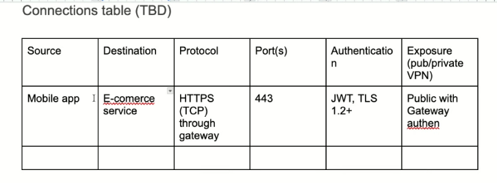
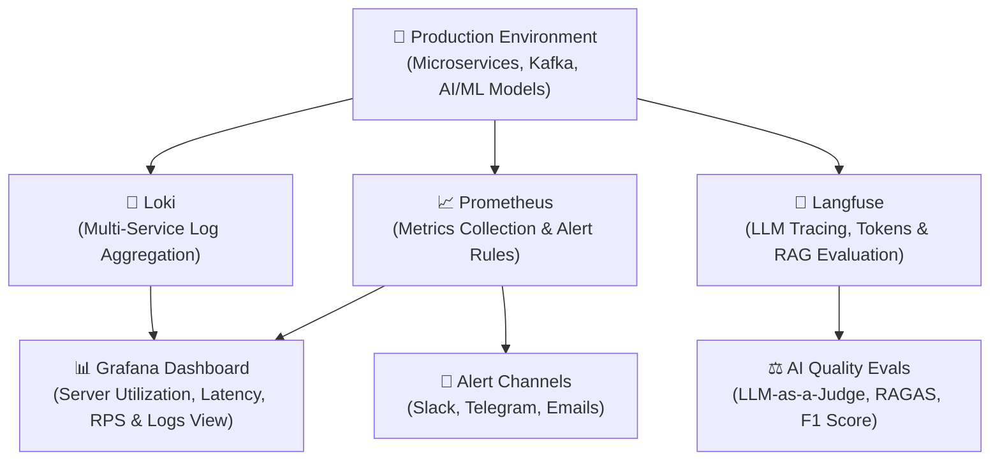
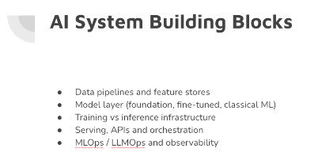
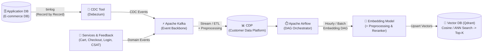
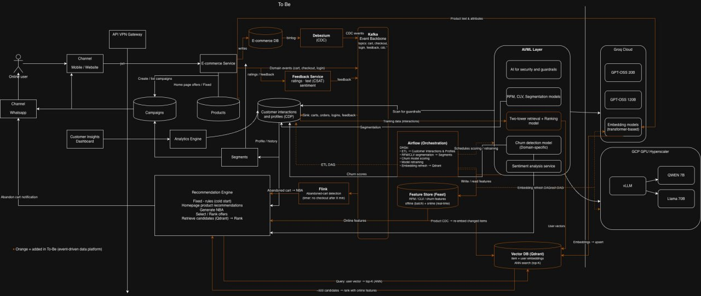
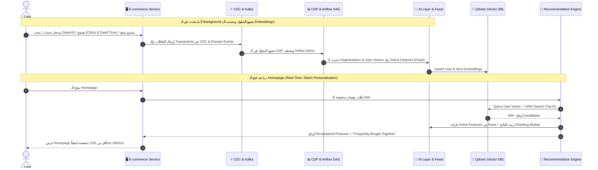

> 🌐 **[اضغط هنا لفتح النسخة التفاعلية الكاملة (RTL Web Page) على GitHub Pages](https://aya-aboulwafa.github.io/ai-architecture-portfolio/#session-2)**

# 🏗️ AI Architecture — Session 2: Viewpoints, Event-Driven Data Platform (CDC, Kafka, CDP) & Production AI Stack

> [!abstract] 🌐 مصادر السيشن والفكرة الجوهرية
> - 🌐 **النسخة التفاعلية الموحدة (GitHub Pages):** [https://aya-aboulwafa.github.io/ai-architecture-portfolio/#session-2](https://aya-aboulwafa.github.io/ai-architecture-portfolio/#session-2)
> - ⏮️ **ملخص السيشن الأولى:** [study/session-1-notes.md](session-1-notes.md) | [Session 1 Web Page](https://aya-aboulwafa.github.io/ai-architecture-portfolio/)
> 
> **الفكرة الجوهرية للـ Session:**
> الانتقال من التخطيط المعماري العام إلى **التصميم الهندسي التفصيلي لمنصة ذكاء اصطناعي مبنية على الأحداث (`Event-Driven AI Architecture`)**؛ من خلال استكمال الزوايا المعمارية (`Context`, `Deployment`, `Information`, `Operational Viewpoints`)، وتحديد عقود البيانات (`API & Data Contracts`)، وفصل قاعدة بيانات الـ `Application` عن منصة بيانات العملاء (`CDP`)، وبناء خط أنابيب بيانات متكامل (`CDC` $\rightarrow$ `Kafka` $\rightarrow$ `CDP` $\rightarrow$ `Airflow` $\rightarrow$ `Feature Store` & `Qdrant Vector DB`)، مع مراقبة شاملة في الـ `Production` (`Grafana`, `Langfuse`, `Loki`, `Prometheus`).

---

# 📘 الجزء الأول: الزوايا المعمارية، السياسات، والعقود (Architectural Viewpoints, Policies & Contracts)

## 🌐 1. زاوية السياق وبوابة النظام (`Context Viewpoint & API Gateway`)
لما بنبص للـ `System` من زاوية الـ **`Context Viewpoint`** (علاقة النظام بالـ `Users` والقنوات الخارجية):
- **دور الـ `API Gateway / VPN Gateway`:**
  - أي `API Request` داخل للـ `System` (سواء من `Mobile App` أو `Website` أو `WhatsApp Channel`) لازم يمر أولاً عبر **`API Gateway`**.
  - كل `API` لازم يكون مطبق عليه **`Authentication & Authorization`** (مثل التحقق من هويات الـ `Users` باستخدام `JWT Tokens` وتأمين الاتصال عبر `TLS 1.2+`).
- **التمثيل المعماري (`Context Diagram`):**
  - يفضل رسم `Diagram` خاص بالـ `Context Viewpoint` يوضح حدود النظام (`System Boundary`)، والـ `Channels` الخارجية، ونقطة الدخول الموحدة عبر الـ `API Gateway`.

---

## 🚀 2. زاوية النشر وتخطيط السعة (`Deployment Viewpoint & Capacity Planning`)
في الـ **`Deployment Viewpoint`** بنترجم التصميم البرمجي إلى بنية تحتية وهاردوير فعلي:
- **تخطيط السعة (`Capacity Planning`):**
  - حساب حجم الترافيك المتوقع، وعدد الـ `Concurrent Requests`، وحجم البيانات لتحديد الموارد المطلوبة بدقة.
- **الحد الأدنى لمكونات الهاردوير (`Minimum Hardware Components`):**
  - تحديد الـ `Minimum Specs` اللازمة لتشغيل كل `Service` (عدد الـ `vCPUs`، حجم الـ `RAM`، مساحة الـ `Storage / NVMe`، ووحدات الـ `GPU` المطلوبة لعمليات الـ `Model Inference` والـ `Embedding`).

---

## 🔗 3. جدول الاتصالات والشبكات (`Connections Table`)

- **أهمية الـ `Connections Table`:**
  - بيبقى مفيد وأساسي جداً خصوصاً في الشرح والتنسيق مع الـ **`DevOps Team`** والـ **`Security Team`** عشان الكل يبقى عارف كل `Connection` جوه الـ `System` ماشي إزاي، وعلى أي `Port`، وإيه نوع الـ `Authentication`، وهل هو `Public` ولا `Private VPN`.

### نموذج تطبيقي لـ `Connections Table`:

| Source (`المصدر`) | Destination (`الوجهة`) | Protocol (`البروتوكول`) | Port(s) (`المنفذ`) | Authentication (`التوثيق`) | Exposure (`Public / Private VPN`) |
| :--- | :--- | :--- | :--- | :--- | :--- |
| **`Mobile App / Website`** | `E-commerce Service` | `HTTPS (TCP)` through Gateway | `443` | `JWT`, `TLS 1.2+` | **Public** with Gateway Auth |
| **`E-commerce DB`** | `Debezium (CDC)` | `TCP (MySQL/Postgres Binlog)` | `3306` / `5432` | `DB Service Account + TLS` | **Private** (Internal Network / VPN) |
| **`Debezium / Services`** | `Kafka Event Backbone` | `TCP (Kafka Protocol)` | `9092` / `9093` | `SASL/SCRAM` or `mTLS` | **Private** (Internal Cluster) |
| **`Recommendation Engine`** | `Vector DB (Qdrant)` | `gRPC` / `HTTP` | `6333` / `6334` | `API Key + Internal TLS` | **Private** (Internal AI Subnet) |
| **`AI/ML Layer`** | `Groq Cloud / External LLM` | `HTTPS (TCP)` | `443` | `Bearer API Key + TLS 1.3` | **Outbound Egress** (Encrypted) |

---

## 📜 4. سياسة البيانات وعقود الـ API (`Data Policy & API / Data Contracts`)

### أ) سياسة الاحتفاظ بالبيانات (`Data Retention Policy`)
- **قاعدة حفظ البيانات (`5-Year Retention`):**
  - كل الـ `Data` الخاصة بالـ `Users` وتفاعلاتهم هتكون متخزنة لمدة **5 سنوات على الأقل (`Minimum 5 Years`)**.
  - هذا يخدم غرضين: الالتزام بالقوانين والتدقيق (`Compliance & Auditing`)، وتوفير سجل تاريخي غني (`Historical Data`) لتدريب نماذج الذكاء الاصطناعي (`ML Models` مثل الـ `CLV` والـ `Churn` والـ `Seasonality`).

### ب) عقود الـ API والبيانات (`API & Data Contracts`)
- **دور الـ `API & Data Contract`:**
  - يوضح بالتفصيل كل الـ `API Endpoints` اللي الـ `System` محتاجها، وشكل الـ `Request / Response Payload`، والـ `Data Schemas`.
- **أفضل ممارسة للتوثيق (`Separate Living Docs`):**
  > [!tip] نصيحة معمارية مهمة
  > يفضل دايماً إن الـ **`API & Data Contracts`** تكون موجودة في **`Docs` منفصلة** ومستقلة عن وثيقة التصميم المعماري الأساسية (`ADD`)، لأن الـ `Endpoints` والـ `Contracts` بطبيعتها **متغيرة باستمرار أثناء العمل والتطوير (`Iterative Development`)**.

---

## 🗄️ 5. زاوية البيانات: الفرق بين `Application DB` ومنصة `CDP` (`Information Viewpoint`)

في الـ **`Information Viewpoint`**، من أهم القرارات المعمارية هو الفصل التام بين قاعدة بيانات التطبيق الأساسية (**`Application Database`**) ومنصة بيانات العملاء (**`CDP - Customer Data Platform`**):

| وجه المقارنة | 🏢 `Application Database` (`E-commerce DB`) | 📊 `CDP (Customer Data Platform)` |
| :--- | :--- | :--- |
| **الغرض الأساسي** | شايلة الحاجات الأساسية اللي بتشغل الـ `Application` لحظياً (`OLTP`). | تجميع وتتبع (`Track`) كل ما يخص الـ `User Behavior` وبناء ملف موحد للعميل (`Unified Customer Profile`). |
| **نوع الـ `Data` المخزنة** | تحتوي على الـ `Schema` والـ `Functions` والبيانات التشغيلية الأساسية فقط (`Users`, `Products`, `Orders`). | - `User Behavior`: الـ `Clicks`، الوقت المقضي في كل `Page` (`Dwell Time`)، والـ `Actions` اللي عملها على الـ `System` (`Carts`, `Orders`, `Logins`, `Feedback`). - `User Info`: `Name`, `Phone Number`, `IP Address`, إلخ. |
| **علاقتها بـ `ML Models`** | ⚠️ **لا يُنصح أبداً بتخزين `Data` خاصة بالـ `ML Models` هنا** عشان منعملش حمل (`Load`) يبطئ الـ `Application`. | المصدر الرئيسي والآمن لتغذية الـ `Airflow DAGs`، والـ `Feature Store`، وتدريب الـ `ML Models`. |
| **طريقة انتقال الـ `Data`** | أي تعديل فيها بيتسحب لحظياً ويروح إلى **`Kafka`** عن طريق **`CDC`**. | الـ `Data` بتتخزن فيها عن طريق **`ETL Job`** أو `Stream Sink` بعد ما يتعمل عليها **`Preprocessing`** وتنظيف. |

---

## ⚙️ 6. زاوية التشغيل، المراقبة، والتصريح الأمني (`Operational Viewpoint, Observability & Security Clearance`)

### أ) زاوية التشغيل وأرقام الأداء القياسية (`Operational Viewpoint & Release SLAs`)
الـ **`Operational Viewpoint`** بيحدد القواعد والأرقام القياسية (`Performance SLAs / Quality Gates`) اللي **مينفعش يقل عنها أي `Release` جديد**.  
بالتالي، الـ **`Testing / QA Team`** بيحتاج مع كل `Release` يختبر الأرقام دي أو يعمل لها **`Automation`** داخل الـ `CI/CD Pipeline`:

1. **`P50 Latency`:** تكون **أقل من `100ms`** (أي أن 50% من الـ `Requests` ترد في أقل من 100 ملي ثانية).
2. **`P95 Latency`:** تكون في حدود **`500ms`** كحد أقصى (أي أن 95% من الـ `Requests` ترد في أقل من نصف ثانية).
3. **`Throughput`:** قدرة الـ `System` على استيعاب **`1000 RPS` (`Requests Per Second`)**.

---

### ب) منظومة المراقبة في بيئة الإنتاج (`Observability Stack in Production`)
الـ **`Observability`** هي اللي بتساعدنا نتأكد إن الـ `Application` وموديلز الـ `AI` شغالين كويس وبكفاءة في الـ **`Production`**، وتتكون من 4 أدوات متكاملة:

1. **`Grafana` (لوحة المراقبة الموحدة):**
   - عبارة عن `Dashboard` تفاعلية بتوضح الـ **`Resource Utilization`** (استهلاك الـ `CPU`, `RAM`, `GPU`)، وبتراقب حالة الـ `Servers` والـ `Logs` والـ `Latency` في مكان واحد.
2. **`Langfuse` (مراقبة وتقييم الـ `LLMs` والـ `AI Agents`):**
   - أداة أساسية لـ `LLMOps` بنشوف ونتابع منها:
     - الـ **`Tracing`** الكامل لكل خطوة في الـ `AI Pipeline`.
     - الـ **`Chunks Retrieved`** من الـ `Vector DB` والـ **`Model Output`** النهائي.
     - المقاييس مثل **`F1 Score`**، وعدد الـ **`Tokens`** (`Input Tokens` & `Output Tokens`)، والـ **`Metadata`** وحساب التكلفة.
     - التقييم الأوتوماتيكي المستمر باستخدام **`LLM-as-a-Judge`** وإطار عمل **`RAGAS`** لعمل `Evaluation` لجودة الـ `Retrieval` والـ `Generation`.
3. **`Loki` (تجميع السجلات المركزي):**
   - بيظهر ويجمع الـ **`Logs`** الخاصة بأكتر من `Service` مع بعض في نفس الوقت لتتبع `Events` أو أخطاء معينة عبر الـ `System` كله.
4. **`Prometheus` (المقاييس والتنبيهات الفورية):**
   - يجمع الـ `Time-series Metrics` ويبعت **`Alerts`** فورية على `Channels` مختلفة مثل **`Slack`**، و **`Telegram`**، و **`Emails`** أول ما يحصل أي تجاوز في الـ `Latency` أو سقوط لأي `Service`.

---

### ج) التصريح والفحص الأمني (`Security Clearance`)
- **متى وأين يتم الـ `Security Clearance`؟**
  - بيتعمل على بيئة ما قبل الإنتاج (**`Pre-prod / Staging Environment`**) أو من خلال **`Security Survey / Audit`** شامل للتأكد من إغلاق كافة الثغرات وصلاحية الـ `Guardrails` قبل السماح بالـ `Deployment` على الـ `Production`.

---
---

# 🧠 الجزء الثاني: اللبنات الأساسية لأنظمة الـ AI وتدفق البيانات (AI System Building Blocks & Data Pipeline)

## 🧱 1. اللبنات الخمس الأساسية لأي نظام ذكاء اصطناعي (`AI System Building Blocks`)

أي `System` في الـ `Production` بيستخدم `AI Feature` لازم يغطي النقاط والمكونات الـ 5 الأساسية دي:
1. **`Data pipelines and feature stores`:** خطوط أنابيب نقل ومعالجة الـ `Data` (`Kafka`, `CDC`, `Airflow`) ومخازن الـ `Features` (`Feast`).
2. **`Model layer (Foundation, Fine-tuned, Classical ML)`:** طبقة النماذج سواء كانت `Foundation LLMs`، أو موديلز معمول لها `Fine-tuning`، أو `Classical ML Models` (مثل `RFM`, `CLV`, `Churn`, `Two-Tower Ranking`).
3. **`Training vs. Inference Infrastructure`:** الفصل بين البنية التحتية المخصصة للـ `Training` (اللي بتحتاج `Batch GPU Jobs`) والبنية المخصصة للـ `Inference` اللحظي (`Groq Cloud` أو `vLLM` على `GCP GPU Hyperscaler`).
4. **`Serving, APIs and Orchestration`:** طريقة تقديم الموديل كـ `API` وتنسيق العمل بين الموديلز والـ `Data` (`Airflow`, `FastAPI / gRPC`).
5. **`MLOps / LLMOps and Observability`:** أتمتة دورة حياة الموديل ومراقبته المستمرة (`Langfuse`, `Prometheus`, `Grafana`).

---

## 🎯 2. كيف تختار الـ `AI Model` المناسب وتعمل له `Benchmarking`؟

عند اختيار أي `Model` في الـ `AI Layer`، بنمشي على القواعد العملية التالية:
- **البحث في خلفية تدريب الموديل (`Model Pre-training Research`):**
  - لازم تعمل `Search` كويس عشان تعرف الـ `Model` ده متدرب على إيه أكتر، وإيه نقاط قوته وضعفه.
- **الحاجة للـ `Fine-Tuning` حسب المجال (`Domain-Specific Fine-Tuning`):**
  - بعض الـ `Business Domains` المتخصصة (مثل القطاع البنكي أو الطبي أو سلوك عملاء متجر معين) بتحتاج **`Fine-tuning`** لأن الموديل العام مش هيفهم تفاصيل الـ `Domain` لوحده.
- **مفهوم الـ `Benchmarking` الحقيقي:**
  > [!warning] قاعدة مهمة في تقييم الموديلز
  > الـ **`Benchmarking`** الصح بيبقى **على حسب احتياجاتك وتجربتك والـ `Business Domain` بتاعك** (باستخدام `Evaluation Dataset` من داتا المشروع نفسه)، **مش مجرد الاعتماد على `Global Benchmark` عالمي أو عام!**

### الأبعاد الثلاثة لاختيار الموديل (`The 3 Dimensions of Model Selection`):
1. **اللغة (`Language`):** هل الـ `Model` بيدعم اللغة المطلوبة (مثلاً العربية واللهجات المحلية بجانب الإنجليزية) بدقة عالية؟
2. **مجال العمل وبيئة التشغيل (`Business Domain & Operating Environment`):** الـ `Model` هيشتغل وهيعمل `Operate` فين؟ في **جهة حكومية (`Government`)**، ولا **بنك (`Bank`)**، ولا **`E-commerce`**؟ (لأن ده بيفرض قيود صارمة على الـ `Data Privacy`، وهل مسموح نستخدم `Cloud API` ولا لازم `On-Premise / Private GPU`).
3. **المهمة المطلوبة (`Target Task`):** إيه الـ `Task` المطلوبة منه تحديداً؟ (`Segmentation`، `Churn Prediction`، `Sentiment Analysis`، `Embedding`، أو `Text Generation`).

> [!tip] نصيحة عند رسم الـ `Architecture Diagrams` بمساعدة الـ `AI`
> الـ `Diagram` المعماري ممكن تستعين بالـ `AI` عشان يساعدك في رسمه بسرعة، **ولكن أنت كـ `Architect` لازم تعمل `Guide` وتوجيه دقيق للـ `AI`** وتراجع كل سهم وكل مكون بنفسك، لأن القرار المعماري مسؤوليتك أنت.

---

## 🔄 3. رحلة الـ `Data` والـ `Embeddings` والـ `Vector DB` (`CDC` $\rightarrow$ `Kafka` $\rightarrow$ `CDP` $\rightarrow$ `Qdrant`)

عشان نبني `Real-time & Batch AI Pipeline` قوي، الـ `Data` بتمشي في الخطوات المتسلسلة دي:

1. **أداة الـ `CDC (Change Data Capture)` مثل `Debezium`:**
   - بتراقب الـ `binlog` بتاع الـ `Database` وتسحب التغييرات **`Record by Record`** وتوديها مباشرة إلى `Kafka` بدون ما تبطئ الـ `Application Database`.
2. **منصة `Apache Kafka (Event Backbone)`:**
   - هي العمود الفقري للأحداث؛ بتجمع الـ `Data` من الـ `Database` (عن طريق `CDC`)، ومن الـ `Services` المختلفة، والـ `Domain Events` (`Cart`, `Checkout`, `Login`)، والـ `User Feedbacks`.
3. **منصة بيانات العملاء `CDP (Customer Data Platform)`:**
   - بتستقبل الـ `Data` المجمعة عشان تكون كلها في مكان موحد، ومن الـ `CDP` نقدر ناخد الـ `Data` ونوديها للـ **`Airflow`** أو نستخدمها في الـ `Model Training`.
4. **مرحلة الـ `Embedding Model` والـ `Reranker`:**
   - لازم نختار **`Embedding Model`** مناسب لطبيعة النصوص والمنتجات.
   - ممكن نعمل **`Preprocessing`** قبل مرحلة الـ `Embedding`، ونستخدم **`Reranker`** لترتيب النتائج بعد الاسترجاع.
   - وممكن نولد الـ `Embedding` باستخدام **`Generative Model`** لو بنتعامل مع `Complex Context Text`.
5. **قاعدة البيانات المتجهة `Vector DB (Qdrant)`:**
   - الـ `Data` بعد ما يتعمل لها `Embedding` بتتخزن كـ `Vectors` جوه **`Qdrant`** (`Item Embeddings` + `User Embeddings`).
   - الـ `Qdrant` بتقدر تعمل جواها **`Cosine Similarity / ANN Search`** بسرعة فائقة وترجع لنا أفضل النتائج (**`Top-K Candidates`**).

---
---

# 🗺️ الجزء الثالث: شرح المعمارية الكاملة للنظام المستهدف (`To-Be Event-Driven Architecture` & `Use Cases`)

## 🏗️ 1. قراءة تفصيلية في مخطط الـ `To-Be Architecture Diagram`

> [!info] 💡 مفتاح قراءة المخطط المعماري (`To-Be Diagram Legend`)
> - **المكونات باللون الأبيض/الرمادي:** تمثل مكونات النظام الأساسي (`Core E-Commerce, Channels, Gateway, Databases`).
> - **المكونات والأسهم باللون البرتقالي (`Orange`):** تمثل الإضافات الجديدة في الـ **`To-Be Architecture`** الخاصة بمنصة البيانات المبنية على الأحداث (`Event-Driven Data Platform`) وربطها بطبقات الـ `AI/ML`.

### تفصيل المكونات والتدفقات داخل الـ `Diagram`:

1. **القنوات، الـ `Dashboards`، وقواعد البيانات التشغيلية (الجانب الأيسر):**
   - **`Online User`** يتفاعل عبر قناتين: **`Mobile / Website`** و **`WhatsApp Channel`**، ويمر الاتصال عبر **`API VPN Gateway`** مؤمناً بـ `JWT`.
   - **`Customer Insights Dashboard`** تتصل بـ **`Analytics Engine`** التي تقرأ من الـ `CDP`.
   - **`E-commerce Service`** يتعامل مع 3 قواعد بيانات أساسية:
     - **`E-commerce DB`** (تُسجل فيها العمليات، ومنها يخرج الـ `binlog` إلى `Debezium CDC`).
     - **`Products DB`** (بيانات المنتجات والعروض الثابتة `Homepage Offers / Fixed`).
     - **`Campaigns DB`** (الحملات التسويقية التي تتغذى من الـ `Segments` وترسل أيضاً للـ `CDP`).

2. **خط أنابيب الأحداث والـ `CDP` (`CDC` $\rightarrow$ `Kafka` $\rightarrow$ `Preprocessing` $\rightarrow$ `CDP`):**
   - مسار التغييرات: `E-commerce DB` $\rightarrow$ `Debezium (CDC)` $\rightarrow$ `Kafka Event Backbone` (`topics: cart, checkout, login, feedback, cdc.*`).
   - كما يرسل **`Feedback Service`** تقييمات العملاء وتحليل المشاعر (`Ratings + Text CSAT Sentiment`) إلى `Kafka`.
   - تصب هذه الأحداث في **`Customer Interactions and Profiles (CDP)`** الذي يجمع الـ `Data` من عدة مصادر في مكان واحد، مما يتيح لنا عمل `Model Training` أو استخراج الـ `Features` لأي غرض.

3. **معالجة السلة المتروكة لحظياً عبر `Apache Flink` (`Real-Time Stream Processing`):**
   - يقرأ **`Flink`** الأحداث لحظياً من `Kafka` لاكتشاف سلة المشتريات المتروكة (**`Abandoned-cart detection`** عبر `Timer`: إذا لم يتم الـ `Checkout` بعد $X$ دقيقة).
   - يرسل إشارة فورية (`Abandoned Cart` $\rightarrow$ `NBA`) إلى الـ **`Recommendation Engine`** الذي يرسل بدوره **`Abandon Cart Notification`** مخصصة للـ `User` عبر **`WhatsApp`**.

4. **التنسيق والجدولة عبر `Apache Airflow` ومخزن السمات `Feature Store (Feast)`:**
   - **`Airflow (DAG Orchestrator)`:** هو المايسترو الذي يأخذ الـ `Data` من الـ `CDP`، ويشغل الـ `Models`، ويأخذ الـ `Output` من الـ `Model` ليوديه إلى الـ **`Feature Store (Feast)`**.
   - **مرونة الـ `DAGs` في `Airflow`:**
     - الـ `DAG` ممكن يشتغل **`Near Real-time`** أو **`Batch`** (كل دقيقة، أو كل ساعة، أو كل يوم).
     - أمثلة الـ `DAGs` الموجودة في المعمارية:
       1. `ETL -> Customer Interactions & Profiles (CDP)`.
       2. `RFM / CLV Segmentation -> Segments`.
       3. `Churn Model Scoring`.
       4. `Model Retraining`.
       5. **`Hourly Embedding Refresh DAG -> Qdrant`** (ممكن نعمل `DAG` يشتغل كل ساعة يعمل `Embedding` للمنتجات والتحديثات الجديدة ويرفعها لـ `Qdrant`).
   - **`Feature Store (Feast)`:** يخزن الـ `RFM / CLV / Churn Features` في طبقتين: **`Offline (Batch)`** للتدريب، و **`Online (Real-time)`** لخدمة الـ `Recommendation Engine` لحظياً.

5. **طبقة الذكاء الاصطناعي والبنية التحتية للحوسبة (`AI/ML Layer`, `Groq Cloud`, `GCP GPU Hyperscaler`):**
   - **`AI/ML Layer` تحتوي على 5 خدمات ذكية:**
     1. `AI for Security and Guardrails` (لفحص المدخلات والمخرجات `Scan for guardrails`).
     2. `RFM, CLV, Segmentation Models` (لتقسيم العملاء وتغذية جدول الـ `Segments`).
     3. `Two-Tower Retrieval + Ranking Model` (لاسترجاع وترتيب التوصيات وبناء الـ `User Vectors`).
     4. `Churn Detection Model (Domain-specific)` (لتوقع احتمالية ترك العميل للمنصة).
     5. `Sentiment Analysis Service` (لتحليل آراء وتقييمات العملاء).
   - **`Groq Cloud`:** يُستخدم لتشغيل موديلز مثل `GPT-OSS 20B`، و `GPT-OSS 120B`، بالإضافة إلى **`Embedding Models (Transformer-based)`** التي تحول `Product Text & Attributes` إلى `Embeddings` وتعمل لها `Upsert` في `Qdrant`.
   - **`GCP GPU Hyperscaler`:** يشغل محرك **`vLLM`** لخدمة النماذج المفتوحة مثل **`Qwen 7B`** و **`Llama 70B`** بكفاءة وسرعة عالية.

---

## 🎯 2. تطبيق عملي على `Functional Use Case`: تخصيص الصفحة الرئيسية (`Homepage Personalization`)

إزاي المعمارية دي بتشتغل فعلياً لما نطبقها على `Use Case` الـ **`Homepage Personalization`**؟

### تفاصيل مسارات العمل في `Homepage Personalization`:
1. **المسار المجدول (`Batch / Scheduled via Airflow DAG`):**
   - ممكن نعملها بـ **`Airflow DAG`** يشتغل دورياً ويشغل الـ `Recommendation System` والـ `Segmentation Models`، فيرجع النتائج الجاهزة إلى الـ `E-commerce Database` أو الـ `Feature Store` لعرضها فوراً.
2. **المسار اللحظي (`Real-time via AI Layer & Qdrant`):**
   - يروح الطلب مباشرة للـ **`Recommendation Engine`** والـ **`AI Layer`**:
     - لو الـ `User` جديد تماماً (`Cold Start`)، بيطبق `Fixed Rules` مبدئية.
     - لو الـ `User` له بصمة وتفاعلات، بيبعت الـ `User Vector` إلى **`Qdrant`** ليعمل `ANN Search (Top-K)` ويرجع حوالي **`~500 Candidates`**، ثم يرتبهم (`Rank`) باستخدام الـ **`Online Features`** من `Feast`.
3. **ماذا يحدث في الـ `Background` أثناء تصفح الـ `User`؟**
   - لما الـ `User` بيسجل في الموقع، أو بيكتب بعض المعلومات عن اهتماماته، أو بيروح يعمل **`Search`** على منتجات معينة، أو بيقعد في كل `Page` وقت معين (`Dwell Time` & `Clicks`):
   - كل الداتا دي بتروح في الـ **`Background`** إلى **`Kafka`** (عبر الـ `CDC` والـ `Domain Events`) $\rightarrow$ ومنها إلى الـ **`CDP`** $\rightarrow$ ثم يسحبها **`Airflow`** $\rightarrow$ ويدخلها على الـ **`AI Layer`**.
   - **مثال تطبيقي (`Cross-Selling / Collaborative Filtering`):** لو الـ `User` اشترى منتج معين، النظام يقترح له تلقائياً: *"الناس اللي اشترت المنتج ده غالباً اشترت معاه كذا وكذا"* (`Frequently Bought Together / Next-Best Action`).

