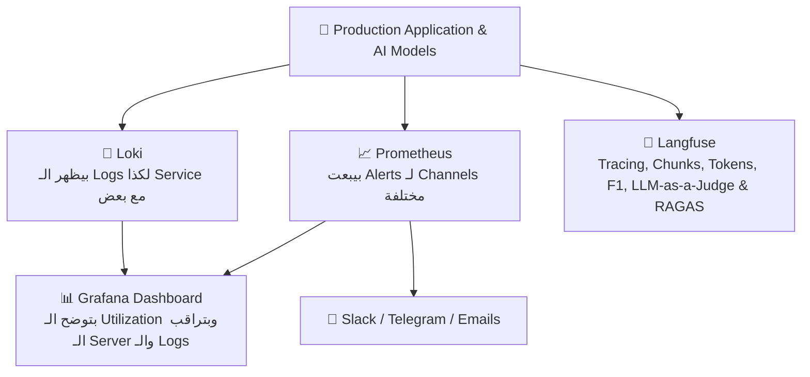
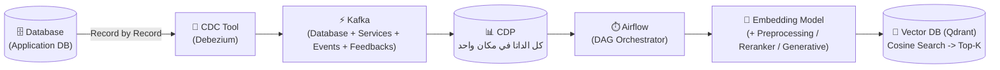
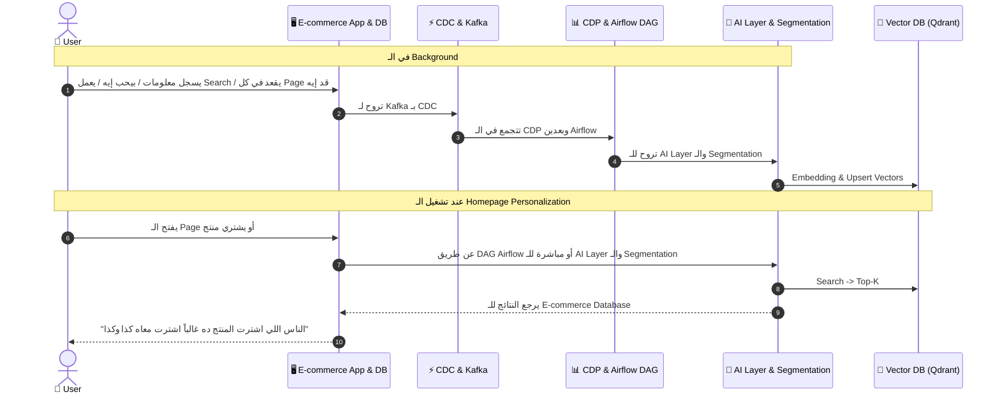

> 🌐 **[اضغط هنا لفتح النسخة التفاعلية الكاملة (RTL Web Page) على GitHub Pages](https://aya-aboulwafa.github.io/ai-architecture-portfolio/#session-2)**

# 🏗️ AI Architecture — Session 2: Viewpoints, Event-Driven Data Platform (CDC, Kafka, CDP) & Production AI Stack

> [!abstract] 🌐 مصادر السيشن والفكرة الجوهرية
> - 🌐 **النسخة التفاعلية الموحدة (GitHub Pages):** [https://aya-aboulwafa.github.io/ai-architecture-portfolio/#session-2](https://aya-aboulwafa.github.io/ai-architecture-portfolio/#session-2)
> - ⏮️ **ملخص السيشن الأولى:** [study/session-1-notes.md](session-1-notes.md) | [Session 1 Web Page](https://aya-aboulwafa.github.io/ai-architecture-portfolio/)
> 
> **الفكرة الجوهرية للـ Session:**
> في الـ Session التانية بنكمّل تطبيق عملي على الـ **Marketing Automation System**؛ بنشوف إزاي نفصّل باقي الـ **Viewpoints** (`Context`, `Deployment`, `Information`, `Operational`)، وإزاي نظبط الـ **Connections Table** والـ **Data & API Contracts**، ونفهم الفرق العملي بين الـ **Application Database** والـ **CDP**، وإزاي الـ **Data** بتمشي خطوة بخطوة من الـ **CDC** لـ **Kafka** لـ **CDP** لـ **Airflow** لحد الـ **Feature Store** والـ **Vector DB (Qdrant)**، وإزاي نراقب الـ **Application** والـ **AI Models** في الـ **Production** بـ (`Grafana`, `Langfuse`, `Loki`, `Prometheus`).

---

# 📘 الجزء الأول: Viewpoints, Data Policy & API Contracts

## 🌐 1. Context Viewpoint & API Gateway
- **`API Gateway`:**
  - أي `API` في الـ `System` لازم يكون فيه **`Authentication & Authorization`** (زي `JWT` و `TLS 1.2+`)، وعشان كدة أي Request جاي من بره لازم يعدي الأول على الـ `API Gateway`.
- **الـ `Diagram`:**
  - الـ `Context Viewpoint` ممكن يبقى ليه `Diagram` خاص بيه يوضّح حدود الـ `System` وعلاقته بالـ `Users` والـ `Channels` الخارجية (`Mobile App` / `Website` / `WhatsApp`).

---

## 🚀 2. Deployment Viewpoint & Capacity Planning
- **`Capacity Planning`:**
  - حساب الـ `System` هيحتاج Resources قد إيه بناءً على حجم الترافيك والشغل.
- **`Minimum Hardware Components`:**
  - بنحدد إيه أقل مكونات `Hardware` مطلوبة عشان تشغّل الـ `System` والـ `AI Models` بتاعتنا من غير مشاكل (`CPU`, `RAM`, `Storage`, `GPUs`).

---

## 🔗 3. Connections Table (TBD)

- الجدول ده بيبقى مفيد جداً خصوصاً في الشرح مع الـ **`DevOps Team`** ولمعرفة كل **`Connection`** جوه الـ `System` ماشي إزاي، منين لفين (`Source` -> `Destination`)، وبأي `Protocol` و `Port`، وإيه نوع الـ `Authentication`، وهل هو `Public` ولا `Private VPN`.

| Source | Destination | Protocol | Port(s) | Authentication | Exposure (Public / Private VPN) |
| :--- | :--- | :--- | :--- | :--- | :--- |
| **`Mobile App`** | `E-commerce Service` | `HTTPS (TCP)` through Gateway | `443` | `JWT`, `TLS 1.2+` | **Public** with Gateway Auth |
| **`E-commerce DB`** | `Debezium (CDC)` | `TCP (Binlog)` | `3306` / `5432` | `DB Credentials + TLS` | **Private** (Internal VPN) |
| **`Debezium / Services`** | `Kafka Event Backbone` | `TCP (Kafka)` | `9092` | `SASL / mTLS` | **Private** (Internal Cluster) |
| **`Recommendation Engine`** | `Vector DB (Qdrant)` | `gRPC` / `HTTP` | `6333` / `6334` | `API Key + TLS` | **Private** (Internal Network) |

---

## 📜 4. Data Policy & API / Data Contract

### أ) Data Policy
- كل الـ `Data` بتاعة الـ **`Users`** هتكون متخزنة لمدة **5 سنوات على الأقل**.

### ب) API & Data Contract
- بيوضّح كل الـ **`API Endpoints`** اللي الـ `System` محتاجها.
> [!tip] ملاحظة عملية
> بيبقى كويس لو الـ **`API & Data Contract`** موجود في **`Docs` منفصلة** لأنها متغيرة باستمرار أثناء العمل.

---

## 🗄️ 5. Information Viewpoint (Application Database vs. CDP)

في الـ **`Information Viewpoint`**، عندنا فرق مهم بين الـ **`Application Database`** وبين الـ **`CDP (Customer Data Platform)`**:

| المقارنة | 🏢 `Application Database` (`E-commerce DB`) | 📊 `CDP (Customer Data Platform)` |
| :--- | :--- | :--- |
| **دورها إيه؟** | بيبقى عليها الحاجات الأساسية اللي تشغّل الـ **`Application`**. | بتعمل **`Track` للـ `User Behavior`** وبتخزن تفاعلات الـ `User` في مكان واحد. |
| **بتخزن إيه بالظبط؟** | بيبقى فيها الـ **`Schema`** والـ **`Functions`** وبس. | - **`Track User Behavior`:** معرفة الـ `Clicks` بتاعته، ووقته على كل `Page` قد إيه، والـ `Actions` بتاعته وعمل إيه على الـ `System` (`Carts`, `Orders`, `Logins`, `Feedback`). - **`Fetch User Info`:** `Name` - `Phone Number` - `IP` - `etc.` |
| **علاقتها بـ `ML Models`** | ⚠️ **لا يُنصح بتخزين `Data` خاصة بـ `ML Models` هنا.** | هي المكان الأساسي اللي بناخد منه `Data` عشان نعمل **`Train`** للـ `Models` أو نغذّي الـ `Airflow` والـ `Feature Store`. |
| **الـ `Data` بتمشي إزاي؟** | بتروح لـ **`Kafka`** (عن طريق الـ `CDC`). | بيتخزن فيها بالـ **`ETL Job`** بعد ما يتعمل عليها **`Preprocessing`** معين وكذا. |

---

## ⚙️ 6. Operational Viewpoint, Observability & Security Clearance

### أ) Operational Viewpoint
- القواعد أو الأرقام اللي **مينفعش يقل عنها كل `Release`**؛ فالـ **`Testing Team`** هيحتاج كل `Release` يختبر الكلام ده أو يعمله **`Automation`** أو كذا:
  1. زي إن الـ **`P50 Latency`** تكون **أقل من `100ms`**.
  2. أو إن الـ **`P95 Latency`** تكون **`500ms`**.
  3. أو الـ **`Throughput`** يكون **`1000 RPS`**.

---

### ب) Observability
اللي بيساعدني أتأكد إن الـ **`Application`** شغال كويس في الـ **`Production`**:

1. **`Grafana`:**
   - عبارة عن **`Dashboard`** بتوضّح الـ **`Utilization`** - بتراقب الـ **`Server`** والـ **`Logs`** وكذا.
2. **`Langfuse`:**
   - بتشوف منها الـ:
     - **`Tracing`** - **`Chunks Retrieved`** - **`Output`** - **`F1 Score`** - **`Tokens`** - **`Input Tokens`** - **`Metadata`**.
     - **`LLM-as-a-Judge`**.
     - **`RAGAS for Evaluation`**.
3. **`Loki`:**
   - بيظهر الـ **`Logs`** لكذا **`Service`** مع بعض عن `Events` معينة.
4. **`Prometheus`:**
   - بيبعت **`Alerts`** لـ `Channels` مختلفة: **`Slack` - `Telegram` - `Emails`**.

---

### ج) Security Clearance
- بيتعمل على الـ **`Pre-prod Environment`** أو **`Survey`**.

---
---

# 🧠 الجزء الثاني: AI System Building Blocks & Data Pipeline

## 🧱 1. AI System Building Blocks

النقاط المهمة اللي لازم تكون موجودة في الـ `System` مادام مستخدم **`AI Feature`**:
1. **`Data pipelines and feature stores`**
2. **`Model layer (foundation, fine-tuned, classical ML)`**
3. **`Training vs inference infrastructure`**
4. **`Serving, APIs and orchestration`**
5. **`MLOps / LLMOps and observability`**

---

## 🎯 2. Model Selection, Fine-Tuning & Benchmarking

- اعمل **`Search`** على الـ **`Model`** متدرب على إيه أكتر.
- بعض الـ **`Business Domains`** ممكن تحتاج **`Fine-tuning`**.
- **الـ `Benchmarking`:**
  > [!warning] ملاحظة مهمة
  > الـ **`Benchmarking`** بيبقى **على حسب احتياجاتك وتجربتك والـ `Domain` بتاعك**، مش `Benchmark` عالمي أو عام!
- **الـ `Dimensions` اللي بتحدد على أساسها الـ `Model`:**
  1. **اللغة (`Language`)**.
  2. **الـ `Business Domain`:** هيشتغل أو هيـ **`Operate`** فين؟ في حكومية (`Government`) ولا بنك (`Bank`) ولا إيه؟
  3. **الـ `Task` المطلوبة منه إيه.**

> [!tip] رسم الـ `Diagram` مع الـ `AI`
> الـ **`Diagram`** ممكن تعمله مع الـ **`AI`**، ولكن أنت لازم تـ **`Guide`** الـ `AI` وكذا.

---

## 🔄 3. Data Pipeline: CDC, Kafka, CDP, Embedding Model & Vector DB (Qdrant)

1. **الـ `CDC Tool` للـ `Data` (زي `Debezium`):**
   - بتسحب **`Record by Record`** من الـ `Data` وتوديه **`Kafka`**.
2. **`Kafka`:**
   - بتجمع الـ `Data` من الـ **`Database`** أو الـ **`Services`** أو الـ **`Events`** والـ **`Feedbacks`**.
3. **الـ `CDP`:**
   - بعدها الـ `Data` كلها ممكن تكون في مكان واحد اللي هو الـ **`CDP`**، اللي منها `Data` ممكن تروح للـ **`Airflow`** مثلاً.
4. **الـ `Embedding Model`:**
   - لازم تشوف `Model` مناسب.
   - ممكن تعمل **`Preprocessing`** قبل مرحلة الـ `Embedding` زي الـ **`Reranker`**.
   - ممكن تعمل `Embedding` بـ **`Generative Model`** لو `Context Text` مثلاً.
5. **الـ `Vector DB` (زي `Qdrant`):**
   - الـ **`Qdrant`** بتقدر تعمل جواها الـ **`Cosine Search`** ويدينا الـ **`Top-K`**.

---
---

# 🗺️ الجزء الثالث: To-Be Architecture Diagram & Functional Use Cases

## 🏗️ 1. To-Be Architecture Diagram

- فيها الـ **`Dashboard`** بتاعة الـ `User` (`Customer Insights Dashboard`)، والـ `Channels` (`Mobile / Website` و `WhatsApp`) اللي بتعدي على الـ `API VPN Gateway`.
- فيها **`E-commerce DB`**، و **`Database Products`**، و **`Database Campaign`**.
- المسار الأساسي للداتا: **`CDC >> Kafka >> Preprocessing >> CDP`**.
- الـ **`CDP`** بتاخد `Data` من كذا مكان، فأقدر أعمل منها **`Train`** أو أياً كان اللي هحتاجه منها.
- الـ **`Campaign`** بتودّي على الـ **`CDP`** كذلك.
- **الـ `Airflow`:**
  - هو **`DAG Orchestrator`** بياخد الـ `Data` من الـ **`CDP`**.
  - بياخد الـ **`Output`** من الـ **`Model`** ويوديها للـ **`Feature Store (Feast)`**.
  - الـ **`DAG`** ممكن يشتغل في الـ **`Real-time` أو `Batch`** كل دقيقة أو كل ساعة أو كذا.
  - ممكن تعمل **`DAG`** كل ساعة يعمل **`Embedding`**.
- **الـ `Flink`:**
  - بيعمل `Abandoned-cart detection` (بـ `Timer` لو مفيش `Checkout` بعد كام دقيقة) ويبعت للـ `Recommendation Engine` عشان يبعت `Abandon cart notification` على الـ `WhatsApp`.
- **الـ `Vector DB (Qdrant)` والـ `AI/ML Layer`:**
  - الـ `Data` بتروح على الـ **`Vector DB`** بعد ما يتعمل لها **`Embedding`**.
  - الـ **`Vector DB`** بتعمل **`Search`** وتدينا الـ **`Top-K`**.
  - والـ **`AI/ML Layer`** فيها (`AI for security and guardrails`, `RFM, CLV, Segmentation models`, `Two-tower retrieval + Ranking model`, `Churn detection model`, `Sentiment analysis service`) متوصلين بـ **`Groq Cloud`** و **`GCP GPU Hyperscaler (vLLM)`**.

---

## 🎯 2. Functional Use Case: Homepage Personalization

- **`Homepage Personalization`:**
  - ممكن نعملها بـ **`DAG Airflow`** يشتغل ويشغّل الـ **`Recommendation System`**، فيرجّع النتائج للـ **`E-commerce Database`**.
  - أو إنه يروح للـ **`AI Layer`** والـ **`Segmentation`**.
- **في الـ `Background`:**
  - لما الـ **`User`** يسجل، بيكتب بعض المعلومات أو بيحب إيه، أو راح عمل **`Search`** على إيه، أو قعد في كل **`Page`** قد إيه $\rightarrow$ بعدها تروح لـ **`Kafka`** بـ **`CDC`** $\rightarrow$ بعدين **`Airflow`** $\rightarrow$ بعدين **`AI Layer`**.
  - ممكن نقترح له مثلاً لو اشترى منتج: **"إن الناس اللي اشترت المنتج ده غالباً اشترت معاه كذا وكذا"**.

