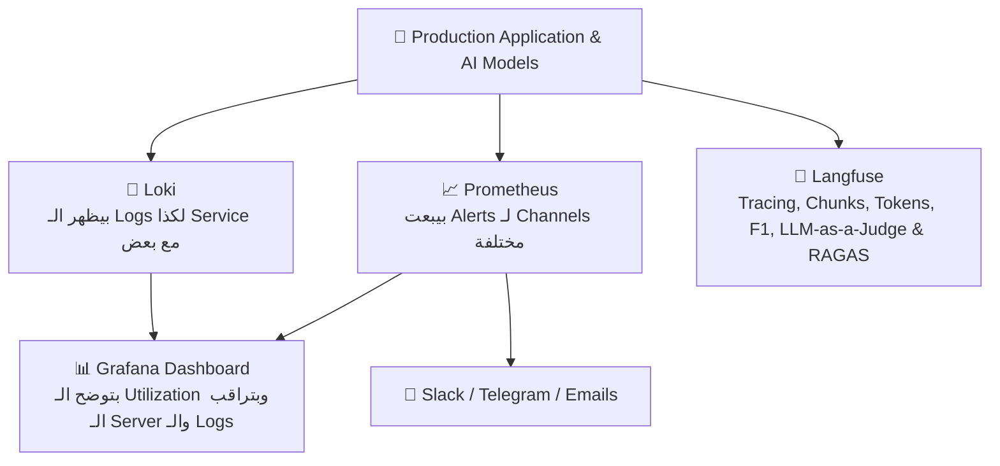
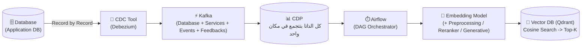
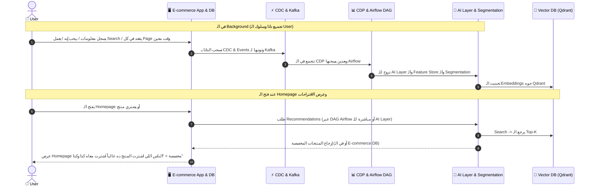

> 🌐 **[اضغط هنا لفتح النسخة التفاعلية الكاملة (RTL Web Page) على GitHub Pages](https://aya-aboulwafa.github.io/ai-architecture-portfolio/#session-2)**

# 🏗️ AI Architecture — Session 2: Viewpoints, Event-Driven Data Platform (CDC, Kafka, CDP) & Production AI Stack

> [!abstract] 🌐 مصادر السيشن والفكرة الجوهرية
> - 🌐 **النسخة التفاعلية الموحدة (GitHub Pages):** [https://aya-aboulwafa.github.io/ai-architecture-portfolio/#session-2](https://aya-aboulwafa.github.io/ai-architecture-portfolio/#session-2)
> - ⏮️ **ملخص السيشن الأولى:** [study/session-1-notes.md](session-1-notes.md) | [Session 1 Web Page](https://aya-aboulwafa.github.io/ai-architecture-portfolio/)
> 
> **الفكرة الجوهرية للـ Session:**
> في الـ Session التانية بنكمّل تطبيق عملي على الـ **Marketing Automation System**؛ بنشوف إزاي نفصّل باقي الـ **Viewpoints** (`Context`, `Deployment`, `Information`, `Operational`)، وإزاي نظبط الـ **Connections Table** والـ **Data & API Contracts**، ونفهم الفرق العملي بين الـ **Application Database** والـ **CDP**، وإزاي الـ **Data** بتمشي خطوة بخطوة من الـ **CDC** لـ **Kafka** لـ **CDP** لـ **Airflow** لحد الـ **Feature Store** والـ **Vector DB (Qdrant)**، وإزاي نراقب الـ **Application** والـ **AI Models** في الـ **Production** بـ (`Grafana`, `Langfuse`, `Loki`, `Prometheus`).

---

# 📘 الجزء الأول: تكملة الـ Viewpoints والـ Policies والـ Contracts

## 🌐 1. زاوية السياق وبوابة النظام (`Context Viewpoint & API Gateway`)
لما بنبص للـ `System` من زاوية الـ **`Context Viewpoint`**:
- **الـ `API Gateway`:**
  - أي `API` في الـ `System` لازم يكون فيه **`Authentication & Authorization`** (زي `JWT` و `TLS 1.2+`)، وعشان كدة أي Request جاي من بره لازم يعدي الأول على الـ `API Gateway`.
- **الـ `Diagram`:**
  - الـ `Context Viewpoint` ممكن يبقى ليه `Diagram` خاص بيه يوضّح حدود الـ `System` وعلاقته بالـ `Users` والـ `Channels` الخارجية (`Mobile App` / `Website` / `WhatsApp`).

---

## 🚀 2. زاوية النشر وتخطيط السعة (`Deployment Viewpoint & Capacity Planning`)
في الـ **`Deployment Viewpoint`** بنركّز على:
- **`Capacity Planning`:**
  - تخطيط السعة وحساب الـ `System` هيحتاج Resources قد إيه بناءً على حجم الترافيك والشغل.
- **`Minimum Hardware Components`:**
  - بنحدد إيه أقل مكونات `Hardware` مطلوبة عشان تشغّل الـ `System` والـ `AI Models` بتاعتنا من غير مشاكل (`CPU`, `RAM`, `Storage`, `GPUs`).

---

## 🔗 3. جدول الاتصالات (`Connections Table - TBD`)

- **ليه بنعمل `Connections Table`؟**
  - الجدول ده بيبقى مفيد جداً خصوصاً في الشرح والتنسيق مع الـ **`DevOps Team`**، وعشان نبقى عارفين كل **`Connection`** جوه الـ `System` ماشي إزاي، منين لفين (`Source` -> `Destination`)، وبأي `Protocol` و `Port`، وإيه نوع الـ `Authentication`، وهل هو `Public` ولا `Private VPN`.

### شكل الـ `Connections Table`:

| Source | Destination | Protocol | Port(s) | Authentication | Exposure (Public / Private VPN) |
| :--- | :--- | :--- | :--- | :--- | :--- |
| **`Mobile App`** | `E-commerce Service` | `HTTPS (TCP)` through Gateway | `443` | `JWT`, `TLS 1.2+` | **Public** with Gateway Auth |
| **`E-commerce DB`** | `Debezium (CDC)` | `TCP (Binlog)` | `3306` / `5432` | `DB Credentials + TLS` | **Private** (Internal VPN) |
| **`Debezium / Services`** | `Kafka Event Backbone` | `TCP (Kafka)` | `9092` | `SASL / mTLS` | **Private** (Internal Cluster) |
| **`Recommendation Engine`** | `Vector DB (Qdrant)` | `gRPC` / `HTTP` | `6333` / `6334` | `API Key + TLS` | **Private** (Internal Network) |

---

## 📜 4. سياسة البيانات وعقود الـ API (`Data Policy & API / Data Contract`)

### أ) الـ `Data Policy`
- كل الـ `Data` بتاعة الـ **`Users`** هتكون متخزنة لمدة **5 سنوات على الأقل** (وده بيفرق معانا في القوانين والـ Compliance وكمان بيوفّر داتا تاريخية نقدر ندرّب عليها الـ `ML Models`).

### ب) الـ `API & Data Contract`
- بيوضّح كل الـ **`API Endpoints`** والـ `Data Schemas` اللي الـ `System` محتاجها عشان الـ `Services` تكلّم بعضها.
> [!tip] نصيحة عملية في التوثيق
> بيبقى كويس جداً لو الـ **`API & Data Contract`** موجود في **`Docs` منفصلة** عن دوكيومنت الـ Architecture الأساسية، لأنها بطبيعتها **متغيرة باستمرار أثناء العمل (`Iterative Work`)**.

---

## 🗄️ 5. زاوية البيانات: الـ `Application Database` مقابل الـ `CDP` (`Information Viewpoint`)

في الـ **`Information Viewpoint`**، مهم جداً نفرّق بين الـ `Application Database` العادية وبين الـ **`CDP (Customer Data Platform)`**:

| المقارنة | 🏢 `Application Database` (`E-commerce DB`) | 📊 `CDP (Customer Data Platform)` |
| :--- | :--- | :--- |
| **دورها إيه؟** | بيبقى عليها الحاجات الأساسية اللي تشغّل الـ **`Application`** (زي الـ `Products` والـ `Orders` والـ `Users`). | مسؤولة إنها تعمل **`Track` للـ `User Behavior`** وتجمع كل تفاعلات الـ `User` في مكان واحد. |
| **بتخزن إيه بالظبط؟** | بيبقى فيها الـ **`Schema`** والـ **`Functions`** الأساسية وبس. | - **تراك `User Behavior`:** معرفة الـ `Clicks` بتاعته، ووقته على كل `Page` قد إيه (`Dwell Time`)، والـ `Actions` بتاعته وعمل إيه على الـ `System` (`Carts`, `Orders`, `Logins`, `Feedback`). - **`Fetch User Info`:** زي الـ `Name` - `Phone Number` - `IP` - `etc.` |
| **علاقتها بـ داتا الـ `ML Models`** | ⚠️ **لا يُنصح بتخزين `Data` خاصة بـ `ML Models` هنا** عشان منأثرش على سرعة الـ `Application`. | هي المكان الأساسي اللي بناخد منه داتا عشان نعمل **`Train`** للـ `Models` أو نغذّي الـ `Airflow` والـ `Feature Store`. |
| **الـ `Data` بتمشي إزاي؟** | الداتا والتعديلات اللي فيها بتروح على طول لـ **`Kafka`** (عن طريق الـ `CDC`). | الداتا بتتخزن فيها بالـ **`ETL Job`** بعد ما يتعمل عليها **`Preprocessing`** معين وكذا. |

---

## ⚙️ 6. زاوية التشغيل، والـ `Observability`، والـ `Security Clearance`

### أ) الـ `Operational Viewpoint`
- هنا بنحط **القواعد أو الأرقام القياسية اللي مينفعش يقل عنها كل `Release`**؛ فالـ **`Testing Team`** هيحتاج في كل `Release` يختبر الكلام ده أو يعمله **`Automation`** عشان يتأكد إن الـ `System` محافظ على كفاءته:
  1. زي إن الـ **`P50 Latency`** تكون **أقل من `100ms`**.
  2. أو إن الـ **`P95 Latency`** تكون **`500ms`**.
  3. أو إن الـ **`Throughput`** يكون **`1000 RPS`** (`Requests Per Second`).

---

### ب) الـ `Observability` (إزاي أتأكد إن الـ `Application` شغال كويس في الـ `Production`؟)
الـ **`Observability`** هي اللي بتساعدني أتأكد إن الـ `Application` والـ `Models` شغالين كويس في الـ **`Production`**، وبنستخدم فيها 4 أدوات أساسية:

1. **`Grafana`:**
   - عبارة عن **`Dashboard`** بتوضّح الـ **`Utilization`**، وبتراقب الـ **`Server`** والـ **`Logs`** وكذا.
2. **`Langfuse`:**
   - دي خاصة بمتابعة وتقييم الـ `LLMs` والـ `AI`، بنشوف منها:
     - الـ **`Tracing`** - الـ **`Chunks Retrieved`** - الـ **`Output`** - الـ **`F1 Score`** - الـ **`Tokens`** - الـ **`Input Tokens`** - والـ **`Metadata`**.
     - وكمان بنعمل بيها تقييم للموديل عن طريق **`LLM-as-a-Judge`** و **`RAGAS for Evaluation`**.
3. **`Loki`:**
   - بيظهر ويجمّع الـ **`Logs`** لكذا **`Service`** مع بعض عن `Events` معينة.
4. **`Prometheus`:**
   - بيراقب الـ `Metrics` وبيبعت **`Alerts`** لـ `Channels` مختلفة زي: **`Slack` - `Telegram` - `Emails`**.

---

### ج) الـ `Security Clearance`
- الـ **`Security Clearance`** بيتعمل على الـ **`Pre-prod Environment`** أو عن طريق **`Survey / Security Audit`** قبل ما نطلع على الـ `Production`.

---
---

# 🧠 الجزء الثاني: الـ `AI System Building Blocks` ورحلة الـ `Data`

## 🧱 1. إيه الحاجات اللي لازم تكون موجودة في أي سيستم بيستخدم `AI Feature`؟ (`AI System Building Blocks`)

دي النقاط المهمة اللي لازم تكون موجودة في الـ `System` مادام مستخدم **`AI Feature`**:
1. **`Data pipelines and feature stores`**
2. **`Model layer (foundation, fine-tuned, classical ML)`**
3. **`Training vs inference infrastructure`**
4. **`Serving, APIs and orchestration`**
5. **`MLOps / LLMOps and observability`**

### إزاي بنختار الـ `Model` ونعمل له `Benchmarking`؟
- **اعمل `Search` على الـ `Model` متدرب على إيه أكتر:** شوف الداتا اللي الموديل اتدرب عليها ونقاط قوته قبل ما تختاره.
- **الـ `Fine-tuning`:** بعض الـ **`Business Domains`** بتكون متخصصة وممكن تحتاج **`Fine-tuning`** عشان تفهم مصطلحات وسياق الشغل ده.
- **الـ `Benchmarking`:**
  > [!warning] نقطة مهمة جداً في الـ Benchmarking
  > الـ **`Benchmarking`** بيبقى **على حسب احتياجاتك وتجربتك والـ `Domain` بتاعك**، مش `Benchmark` عالمي أو عام!
- **الـ `Dimensions` اللي بتحدد على أساسها الـ `Model`:**
  1. **اللغة (`Language`):** الموديل هيتعامل مع عربي ولا إنجليزي ولا لهجات معينة؟
  2. **الـ `Business Domain` وبيئة التشغيل:** هو هيشتغل أو هيـ **`Operate`** فين؟ في **جهة حكومية (`Government`)** ولا **بنك (`Bank`)** ولا إيه؟ (عشان ده بيحكم الـ `Security` والـ `Hosting`).
  3. **الـ `Task` المطلوبة منه إيه:** إيه المهمة اللي هينفذها بالظبط؟

> [!tip] رسم الـ `Diagram` مع الـ `AI`
> الـ **`Diagram`** ممكن تعمله مع الـ **`AI`** ويساعدك فيه، **ولكن أنت لازم تـ `Guide` الـ `AI`** وتوجّهه خطوة بخطوة لأنك أنت اللي فاهم الـ `Architecture` والـ `Business`.

---

## 🔄 2. رحلة الـ `Data` والـ `Embeddings` والـ `Vector DB` (`CDC` $\rightarrow$ `Kafka` $\rightarrow$ `CDP` $\rightarrow$ `Qdrant`)

1. **الـ `CDC Tool` للـ `Data` (زي `Debezium`):**
   - بتسحب **`Record by Record`** من الـ `Data` اللي في الـ `Database` وتوديه على طول لـ **`Kafka`**.
2. **`Kafka`:**
   - بتجمع الـ `Data` من الـ **`Database`**، أو الـ **`Services`**، أو الـ **`Events`** والـ **`Feedbacks`**.
3. **الـ `CDP`:**
   - بعدها الـ `Data` كلها بتكون متجمعة في مكان واحد اللي هو الـ **`CDP`**، واللي منه الـ `Data` ممكن تروح للـ **`Airflow`** مثلاً.
4. **الـ `Embedding Model`:**
   - لازم تشوف وتختار **`Embedding Model`** مناسب للداتا بتاعتك.
   - ممكن تعمل **`Preprocessing`** قبل مرحلة الـ `Embedding`، أو تستخدم حاجة زي الـ **`Reranker`**.
   - وممكن تعمل `Embedding` بـ **`Generative Model`** لو شغال على `Context Text` مثلاً.
5. **الـ `Vector DB` (زي `Qdrant`):**
   - الـ **`Qdrant`** بنخزن فيها الـ `Embeddings`، وبتقدر تعمل جواها الـ **`Cosine Search` (`ANN Search`)** وتدينا الـ **`Top-K`**.

---
---

# 🗺️ الجزء الثالث: شرح الـ `To-Be Diagram` وتطبيق الـ `Functional Use Cases`

## 🏗️ 1. شرح الـ `To-Be Architecture Diagram`

> [!info] 💡 إزاي نقرأ الـ `To-Be Diagram`؟
> كل الأجزاء المرسومة **باللون البرتقالي (`Orange`)** في الـ `Diagram` هي الإضافات الجديدة في الـ **`To-Be`** (`Event-Driven Data Platform` + `AI/ML Layer`).

### تفاصيل المكونات اللي في الـ `Diagram`:
- **الواجهات والـ `Databases` الأساسية:**
  - فيها الـ `Channels` بتاعة الـ `User` (`Mobile / Website` و `WhatsApp`)، وفيها الـ **`Dashboard`** بتاعة الـ `Customer Insights` مع الـ `Analytics Engine`.
  - وفيها الـ `E-commerce DB`، و **`Database Products`**، و **`Database Campaign`**.
- **مسار الـ `CDC >> Kafka >> Preprocessing >> CDP`:**
  - الداتا بتخرج من الـ `E-commerce DB` بـ `Debezium (CDC)` وتروح على **`Kafka`**، وبعدما يتعمل لها **`Preprocessing`** بتروح على الـ **`CDP`**.
  - الـ **`CDP`** بياخد `Data` من كذا مكان (وكمان الـ **`Campaign`** بتودّي على الـ `CDP` كذلك)، فبالتالي أقدر أعمل منه **`Train`** للـ `Models` أو أياً كان اللي هحتاجه منه.
- **الـ `Airflow` والـ `Feature Store (Feast)` والـ `Flink`:**
  - الـ **`Airflow`** هو **`DAG Orchestrator`**: بياخد الـ `Data` من الـ **`CDP`**، وبياخد الـ **`Output`** من الـ **`Model`** ويوديها للـ **`Feature Store (Feast)`**.
  - الـ **`DAG`** ممكن يشتغل في الـ **`Real-time` أو `Batch`** (كل دقيقة، أو كل ساعة، أو كذا).
  - وممكن تعمل **`DAG` كل ساعة يعمل `Embedding`** للداتا الجديدة ويحدّث الـ `Qdrant`.
  - وفيه **`Flink`** بيراقب الـ `Abandoned Cart` (لو الـ `User` حط حاجة في الـ Cart ومعملش `Checkout` بعد $X$ دقيقة) فيبعت للـ `Recommendation Engine` عشان يبعت له `Notification` على الـ `WhatsApp`.
- **الـ `Vector DB (Qdrant)` والـ `AI/ML Layer` والـ `Cloud GPUs`:**
  - الـ `Data` بتروح على الـ **`Vector DB (Qdrant)`** بعد ما يتعمل لها **`Embedding`**.
  - والـ **`Vector DB`** بتعمل **`Search`** وتدينا الـ **`Top-K`** (`~500 Candidates` يترتبوا بالـ `Online Features` اللي في الـ `Feature Store`).
  - وجوه الـ **`AI/ML Layer`** عندنا موديلز الـ `AI for Security and Guardrails`، والـ `RFM, CLV, Segmentation Models`، والـ `Two-tower Retrieval + Ranking Model`، والـ `Churn Detection Model`، والـ `Sentiment Analysis Service`، ومتوصلين بـ **`Groq Cloud`** (`GPT-OSS 20B / 120B` & `Embedding Models`) و **`GCP GPU Hyperscaler`** (`vLLM` عليه `Qwen 7B` و `Llama 70B`).

---

## 🎯 2. تطبيق على `Functional Use Case`: الـ `Homepage Personalization`

إزاي بننفّذ الـ **`Homepage Personalization`** جوه الـ `Architecture` دي؟

### تفاصيل الـ `Homepage Personalization`:
1. **إزاي بتشتغل؟ (طريقتين للتنفيذ):**
   - **الطريقة الأولى:** ممكن نعملها بـ **`DAG Airflow`** يشتغل ويشغّل الـ **`Recommendation System`**، فيرجّع النتائج جاهزة للـ **`E-commerce Database`**.
   - **الطريقة الثانية:** أو إنه يروح مباشرة للـ **`AI Layer`** والـ **`Segmentation`** والـ `Recommendation Engine`.
2. **إيه اللي بيحصل في الـ `Background`؟**
   - لما الـ **`User`** يسجل في الموقع، بيكتب بعض المعلومات عنه أو بيحب إيه، أو راح عمل **`Search`** على إيه، أو قعد في كل **`Page`** قد إيه (`Clicks & Dwell Time`).
   - بعدها الداتا دي كلها بتروح في الـ **`Background`** لـ **`Kafka`** بـ **`CDC`** $\rightarrow$ وبعدين **`Airflow`** (عن طريق الـ `CDP`) $\rightarrow$ وبعدين تروح للـ **`AI Layer`**.
   - **مثال عملي للاقتراحات:** ممكن نقترح للـ `User` مثلاً لو اشترى منتج معين: **"إن الناس اللي اشترت المنتج ده غالباً اشترت معاه كذا وكذا"** (`Frequently Bought Together / Next-Best Action`).

